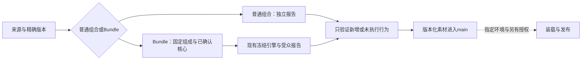

# 最小工作流与真实完成点

版本0.1.1-draft。源于已交接草稿，按当前EVC/F01/F02及独立工具加工事实修订；JD-R未定版、Project未安装，当前文件不等于三项最终目标已经完成。

1. 接收来源、实际版本与目标。复用已有原件、工具与报告；不重建资料hub或重复下载已有PDF。核材料字节/身份时由消费节点自行落地，别使用其他节点的私有路径。权利未知保留未知；可合法研究不等于公开再分发或商业部署均获准，不代联系、签约或共享答卷。
2. 固定产品内容。普通组合只列组成、顺序和独立报告。Bundle另列预选核心→实际scoreKey→方向/转换→理论配置→结果状态与报告。没有科学决定就保留待定，不用“先跑起来”替代。固定必做不等于缺失补零。
3. 配置在现有合同内。源码位于既有scale source或Bundle package路径，用原generator更新索引；不手改生成数量。缺题文/锚点/计分/再分发条件时可保留既有CATALOG_ONLY，不把元数据计为可作答工具。所需新工程只修直接缺口。
4. 一项检查只有一个主要地点。先用实际差异挑必需检查，已有同输入证据按真实可接纳路线复用；不先本地全验、再CI全验、再服务器全验。当前onboarding-structure仅接纳绑定过的具体候选，不是假定所有包都能自动复用；未接通时明确最小接线，禁止用Draft绿代替Ready资格。
5. 新成品需要一个适用完整实例。复用已验共享计分；真正变化的输入/方向/报告/权限/历史读取或入口各补对应断言，避免四入口重复公式。不因普通文字修订重跑模型、PG或浏览器。缺核心、无效、真实零、边界或未匹配等按该模型的实际变化选择，不自动生成每包必跑大矩阵。失败保留原run/命令/输入与首错，只修复、复验受影响项。
6. 新增解释或科学设计做实际需要的内容判断，已审未变内容不重复送审。现有Bundle签审绑定精确内容hash；源码实际要求审核者与安装者不同，发布调用者可以就是该审核者。不要额外要求第三个管理员或逐次答卷批准。
7. 默认完成到main可装载素材。按真实CLI/消费者操作，不从record-template.json编造API。分别记commit/merge、运行环境加载、DB安装、PUBLIC、grant、任务发布/FINAL/报告重开；前一步成功不推定后一步。正式CI相同产物不重建，服务器只作获准的有限就绪/短流程/回退。

报告复用既有ScaleUnitReportCard和BundleProfileSummary；文字、量尺图和独立报告入口一起看。图不能新增虚构维度、常模、红黄绿风险或排名。设计期生成固定内容，线上选已冻结文字，不逐被试调LLM、不另存每人PDF/图片。

当前已实得：EVC PR393报告修订已合main并通过限定CI；BAT12独立报告语言机制及四个TALIS新工具在独立分支局部合同通过，三份TALIS效能仅目录。后者未合main/安装/FINAL，JD-R Bundle仍待用户决定；不能拿EVC验收冒充JD-R完整实例。待该实例实际完成后，只修订本流程暴露的具体缺口，再定版Project文件。
