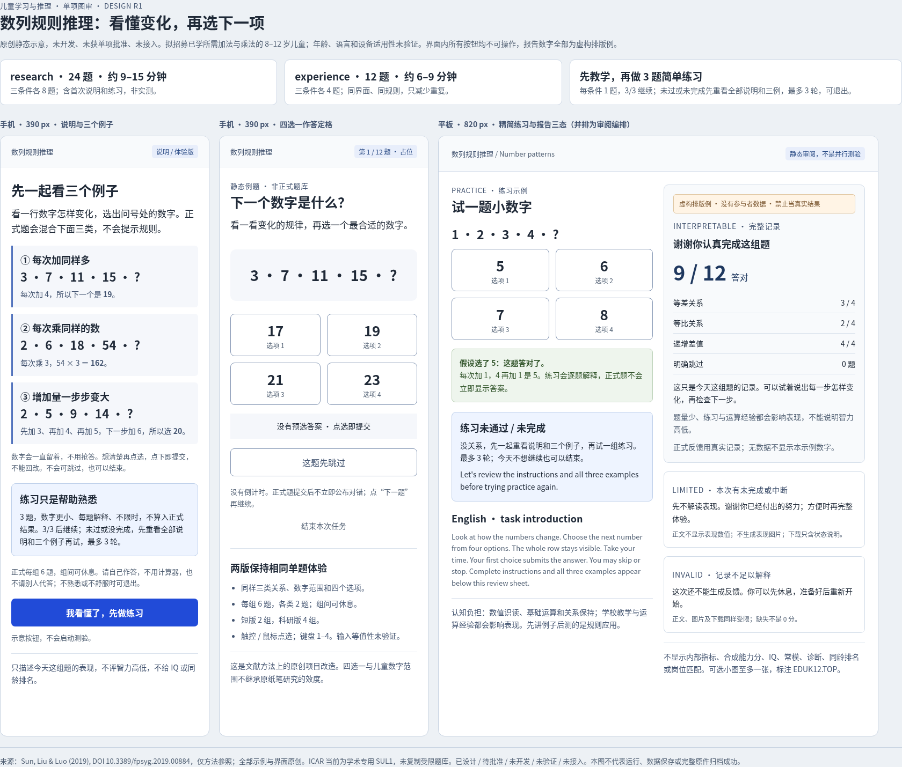

# 儿童学习与推理：本轮图审包

**当前进度更新**：用户已批准本项开发，数列规则推理的独立内容候选已完成，待 DOT 直接复核，未接入或最终验收。[当前代码、实际截图、完整中英报告与原始检查记录](implementation/README.md)。以下保留获批前的图审说明与交付历史；其中“待批准/未开发”及旧文件摘要是当时状态，不替代当前候选状态，也不把开发通过称为人群效度。GitHub 为本次候选交付主路径，实际提交/推送结果以交付回读为准。

状态：**已设计、待单项批准；未开发、未验证、未接入**。独立分支 `cognitive/domain-child-learning-20261027`，只修改本目录；未提交、未 push，交 DOT 直接复核后再安排单项 `[skip ci]` 提交。

跨任务审阅入口：[现有 Notion 认知页中的本项待审图片与短介绍](https://app.notion.com/p/405d27635a3881b2a2d3fecce26d7cb3#26c00a2146234c07b76e3b2ae5a69356)。已追加并回读，原图字节摘要一致；没有修改分享设置。Library 保存因认证 401 未创建文件，未重试写入。正式题库尚未编制、获批后拟自研；科研版难度未经儿童实证标定，与韦氏／瑞文不等价。独立短介绍见 [number-series-brief-20261027.md](number-series-brief-20261027.md)。

**简短实施介绍**：本轮只建议新增“数列规则推理”。看一行数字，从四个选项中选下一项；例如 `3、7、11、15、?`，每次加 4，所以选 19。三种条件为等差、等比、递增差值。research **24 题，每条件 8 题，约 9–15 分钟**；experience **12 题，每条件 4 题，约 6–9 分钟**，含首次说明和练习，均为估算、没有速度期限。两版同界面、同单题规则，短版只减少重复。正式前有完整中英说明和三种例子；练习仅 3 题、每条件 1 题，较小数字、逐题解释，3/3 才继续；未通过或未完成先重呈全部说明与例子，最多 3 轮，可退出。

主要改造：借鉴开放论文的方法，独立写题、四选一触屏点选即提交；不复制 ICAR、韦氏或瑞文材料。拟用于已经学过所需加法与乘法的 **8–12 岁研究招募**，年龄、中文理解、触屏和长短版等值均未验证；教学经验与运算熟练程度会影响结果。只描述本次真实对错、跳过及用时，不输出 IQ、常模、同龄排名、诊断或学业预测。本图片全部为**静态示意**，报告数字为**虚构排版例**，不是参与者数据或已批准测验。

- [静态 HTML，含英文说明与三态报告样稿](review.html)
- [现有 24 旧项目＋11 候选的代码去重清单](reuse-audit.md)
- [来源、分轴许可、协议、公式、版本和 18 维映射附录](number-series-appendix.md)
- [本轮实际核验记录及文件摘要](review-evidence.json)

优先复用已有注意、记忆、加工速度和图形推理项目；**只列 1 个真实协议缺口，不凑第 2 项**。DCCS 保留为已有 cardsort 近邻储备，心与花保留原线程 `01a17ad0-5b23-708e-ae91-fcbb105da090` 的归属。本轮不改 MOT/ANT 暂停 WIP、共享 README、注册表、PR363 或平台。
