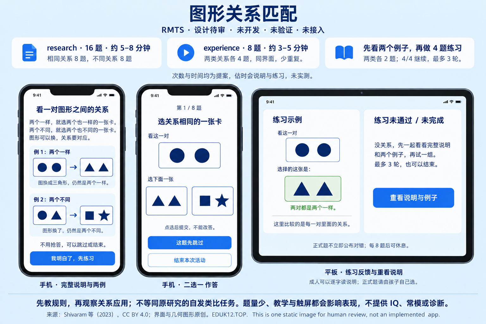

# 图形关系匹配 / Relational match-to-sample

**单项设计 R1 · 待用户图审 · 未开发、未验证、未接入。** stable key 提案：`relational-match-to-sample`。属于儿童学习领域的一般关系推理方案，不是原有数列或矩阵任务的新名字。下图是原创静态图，没有可启动的运行器。

**简短实施介绍：** 先看上面一对图形，再选下面“关系相同”的一张卡。例如上面是 `● ●`，就选 `▲ ▲`；上面是 `● ▲`，就选 `■ ★`。图形可以换，对内“两个一样／两个不同”的关系要对应。research **16题，两类各8，约5–8分钟**；experience **8题，两类各4，约3–5分钟**。两版同界面、同一轮完整条件，短版只减少重复；估时含完整说明、两个例子、四题练习和通常的短休息，均未实测，没有抢答期限。

正式前完整解释两类关系；四题简单练习，两类各两题，逐题解释，**4/4首答正确**才继续。失败或未完成先重呈全部说明和两个例子，再练，最多三轮，可以结束。正式二选一，首次有效点选提交，不能改答，不立即公布对错；可以明确跳过、结束，每8题后可休息。成人可以逐字读说明，正式题由孩子自己选，不提示答案。

主要改造：参照开放论文中的混合关系任务，自绘单色几何卡片，改成触屏，并增加明确教学与简短练习。原研究考察的是**没有预先教学的自发关系匹配**；本方案研究**教学后应用“相同／不同”关系**，不能继承其结论。拟用于能理解说明的儿童非临床研究，具体年龄范围、独立阅读、中文理解和长短版等值均未验证。题量少、教学与触屏会影响表现，与韦氏／瑞文不等价，不输出IQ、常模、诊断、同龄排名或学业预测。

**Brief implementation note (English).** Look at the top pair, then choose the lower card with the same within-pair relation. For example, `● ●` matches `▲ ▲`, while `● ▲` matches `■ ★`. The proposed research profile has **16 items, eight per relation, about 5–8 minutes**; experience has **eight items, four per relation, about 3–5 minutes**. Both retain the same interface and both relations. Estimates include full instructions, two examples, four practice items and typical short rests; they are not measured durations. Practice has two items per relation, with explanations; all four first choices must be correct. Failed or incomplete practice returns to the full instructions and both examples, with at most three rounds and an option to stop. Formal first choices are final, without immediate correctness feedback; skipping and stopping are available. An adult may read the instructions verbatim but must not answer or guide formal choices. Explicit teaching, original monochrome artwork and touchscreen input are adaptations: this studies taught relation application, not spontaneous analogy discovery or IQ, and age/language/profile equivalence is unvalidated.

[来源与许可、原协议、分母／首答／null／有符号公式、三态报告及版本附录](protocol-and-rights.md)。只新增设计材料，不编写运行器、正式序列、题库生成或计分实现。待用户单项图审批准后再开发；不把“下一个”当作对本项具体设计的批准。
