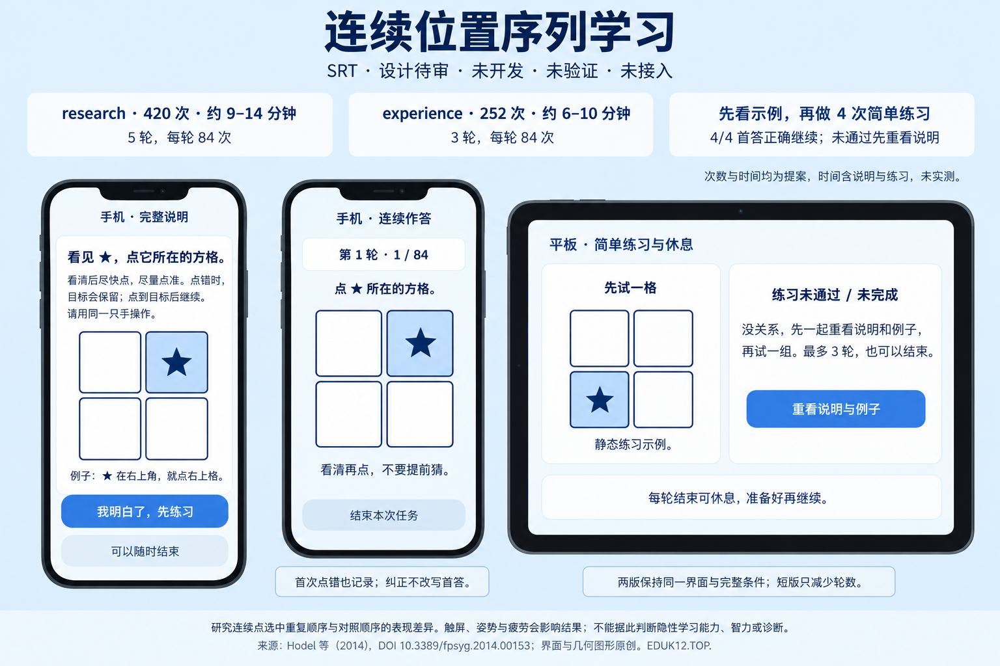

# 连续位置序列学习 / Serial reaction learning

**单项设计 R1 · 待用户图审 · 未开发、未验证、未接入。** stable key 提案：`serial-reaction-learning`。DOT 已确认归属儿童学习领域；归属确认不等于开发批准。以下按钮和任务画面均为静态示意，不会启动测验。

**简短实施介绍：** 四个固定方格中出现一颗 ★，看清后尽快点它所在的方格，尽量点准。例如 ★ 在右上格，就点右上格。点错时目标保留，点到目标后才推进；**首次错答也记录，之后的纠正不会把首答改成正确**。拟采用触屏四格、同一只手操作；不用商业角色图片。research **420 次（5 轮×84），约 9–14 分钟**；experience **252 次（3 轮×84），约 6–10 分钟**，均含初次说明、示例、四次练习和通常的短休息，都是估算，未实测。两版同界面、同一轮完整条件，短版只减轮数。每轮结束可以休息，任务内无抢答倒计时，可随时结束。

正式前先看完整中英说明和一个具体例子；练习仅四次、四位置各一次、不提前练正式重复序列，4/4 **首答**正确才继续。失败或未完成先重呈全部说明与示例，再练，最多三轮；仍未完成可以结束，不生成正式表现。正式部分点错后不显示分数或惩罚动画。研究问题是连续反应中重复顺序与对照顺序的表现差异；不是让孩子回忆或复述顺序。触屏动作距离、姿势、注意、疲劳及练习都会影响结果，不能只凭差值认定“隐性学习能力”。

主要改造：以 Hodel 等（2014）的自定步速条件为方法参照，将独立按钮盒改成原创四格触屏图形，将原 36 次练习缩为四次，并增加三轮体验方案；不沿用其角色、背景、设备参数、原样本排除标准或效度结论。拟供能理解说明并独立操作四格的学龄儿童非临床研究；具体年龄边界、中文理解、长短版及触屏等值均未验证。与韦氏／瑞文不等价，不提供 IQ、常模、诊断、同龄排名或学业／岗位预测。

**Brief implementation note (English).** Tap the square containing ★ as soon as you have seen it, while trying to be accurate. For example, a star in the upper-right square means tap the upper-right square. An incorrect tap is retained as the first response; the target stays until a correct tap, and a correction does not replace that first response. The proposed research profile has **420 trials in five 84-trial runs, about 9–14 minutes**; experience has **252 trials in three complete runs, about 6–10 minutes**. These unmeasured estimates include the introduction, example, four practice trials and typical short rests. Both profiles keep the same interface and all within-run conditions. After complete instructions and an example, practice presents each location once; all four first responses must be correct. Failed or incomplete practice returns to the full instructions and example, with at most three rounds and an option to stop. The touchscreen, original geometric artwork, shorter practice and three-run profile are adaptations, without established equivalence or validity. This studies performance during repeated versus control position sequences; it is not an IQ test, diagnosis or proof of implicit learning.

原方法与许可：[Hodel et al. (2014), DOI 10.3389/fpsyg.2014.00153](https://doi.org/10.3389/fpsyg.2014.00153)，文章注明 CC BY；不复制 Sesame Street 素材。源码参考固定在 jsPsych `5887b4a50f71fe4b93254754956ea488b0a0c16e`（MIT）。[来源、完整条件、首答／分母／有符号公式、报告三态与改造边界](protocol-and-rights.md)。

本包只有原创静态图和设计说明。没有运行器、序列生成器、计分实现或真实参与者数据；没有修改共享注册、已有数列候选或其他领域。待用户图审批准后才安排内容实现。
