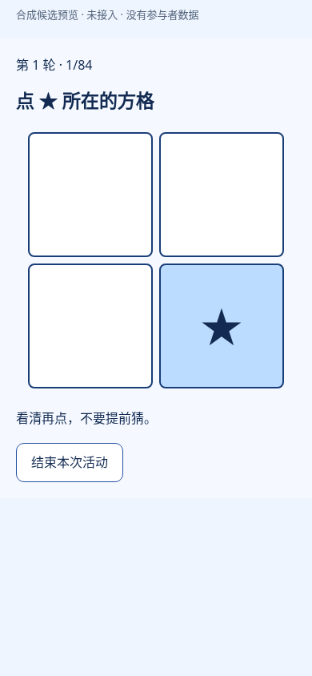

# 连续位置序列学习：独立内容候选

**用户已批准设计并确认体验版缩为两轮；候选已实现并完成限定检查，未 DOT 独审、未产品接入、未最终验收。** GitHub 为交付入口。以下原件和截图全部来自明确标注的合成 fixture，没有参与者数据，没有真实 API／DB／COS 调用；软件检查通过不代表测量效度。

用户确认的体验版为 **168 次＝2 轮×84，预计约 4–7 分钟**；科研版 **420 次＝5 轮×84，约 9–14 分钟**。估时包含初次说明、例子、四次练习和通常的短休息，没有实测，重复练习／纠正／慢速回应可更久。[获批 R2 图稿及中英简短介绍](../designs/serial-reaction-learning/README.md) 保留设计时画面，不是运行截图。

## 已实现的内容

- 后端独立目录：`server-version/backend/src/modules/cognitive/content-candidates/serial-reaction-learning/`。包含版本冻结、完整两种 profile、可重现的受约束对照序列、严格原始记录检查、native V2 scorer、host 可调用的 `finalizeAttempt`、详细中英报告／三态公开投影和受控标签 metadata。没有写共享注册或修改旧测验。
- 实际 React 候选：`server-version/frontend/src/modules/cognitive/tasks/serial-reaction-learning/SerialReactionLearningTask.tsx`。只接收冻结触屏模式；说明／控制按钮可正常激活，但正式四格不把鼠标、键盘或辅助激活冒充触屏首答。完整中英教学和右上 ★ 例子、四次练习、失败／未完成重呈完整说明、最多三轮、轮间休息及结束流程均已实现。
- 首次触屏 `pointerdown` 立即记录四格中任何有效位置，点错后目标保留。第一次位置、首答时间和正确性永不被纠正覆盖；纠正另记，按到目标才推进。一次触摸产生的兼容 click 不得误触随后出现的“继续”或报告操作；新的主动手势正常使用控制按钮。实际操作仅观察普通 DOM commit 软件时钟，无逐帧探测或新增时序预检。
- 名义 RSI 为正确触点后 500 ms。按该触点时间安排普通浏览器定时器，逐题持久化队列不阻塞后续目标；实际下一次 DOM 软件 onset 保留在原件，可反映浏览器延迟，不声称硬件精度。轮间／练习反馈允许用户主动继续。保存失败会停止当前活动并保留原件，同一 draft 幂等重试，不能悄悄恢复中断轮或宣布结果保存成功。
- 主机需先保留 complete context、actual teaching language、manifest 和 realm，再确认新尝试；session 不允许切换 context／language／ports 后继续。正式前要求首答 4/4 的完整练习。host 的候选局部 `finalizeAttempt` 会复核练习、原件顺序、digest、实际冻结参数和终止声明，再调用原生 scorer／公开投影；单独 scorer 是正式原件分析接口，不能替代此 host guard。此处没有实际主机持久化适配器。

## 实际协议与解释

方法参照 [Hodel 等（2014），DOI 10.3389/fpsyg.2014.00153](https://doi.org/10.3389/fpsyg.2014.00153)，取 Experiment 1 self-paced；保留作者公开的两种十位置序列之一。每轮五组 6R＋10S，最后 4R，共 84 次。分析按原方法将每段 10S 开头两次归入 R，最后四次排除比较，所以每轮 **分析 S40、R40**。research 分析 S200／R200／收尾20；experience 分析 S80／R80／收尾8。

论文没有可直接复用的随机化源码。本项目的明确补充：每轮五个 6R 合计 30 次，位置总数按完整 S 的 0.3／0.2 概率匹配为 9／6；收尾四位置各一次。所有实际目标跨条件和轮边界不连续重复。采用固定 FNV1a→xorshift32 与按剩余计数加权的有界回溯构造，**不称对全部有效序列均匀抽样**，无失败后降级为不合条件的随机序列。两版相同 seed 采用相同 variant 和每轮结构，短版是完整两轮，不能按时间／表现临时截取。

重要边界：呈现来源与分析类别分开保留；重分类后两类的位置频率不自动相同，触屏动作成本可能影响差值。原研究使用角色图片和按钮盒、36 次练习；这里改为原创几何触屏、四次练习和两轮体验版。未继承年龄、语言、设备／长短版等值或个体效度，没有意识测验，不称纯隐性学习、IQ／韦氏／瑞文等价版。

权威计算只取每分析条件**首次就点准**的有效反应时间，逐轮求算术平均，再计算 `Δj = meanRT(R,j) − meanRT(S,j)`；全部计划轮等权平均 `Δj`，不能只挑好轮。正差＝本次重复顺序较快，负差＝较慢，真实 0 保留；任一必要条件无正确时间则为 null。总首答计数含收尾，条件均值不含收尾，练习不进正式表现。条件准确率分母是该条件实际有首答次数，并保留计划／呈现／无首答／中断量；未执行不算错。项目不沿用原论文 z 分数或 2.5 SD 删除规则，原始长 RT 保留。

报告三态统一控制正文、可选一张 EDUK12.TOP 图片与下载。只有完整、无中断、逐轮两类首答至少 80% 且必要均值存在时给本次描述；80% 是已列在设计附录中的保守项目规则，**不是已验证效度或诊断截点**。真实但未完成／中断／低准确为 limited，无正式首答为 invalid；不可靠或篡改原件直接拒绝复算，不能生成虚构公开结果。受限状态没有表现 summary、图片或数值导出，内部质量指标均不公开。中英正文、解释、建议和简短限制均已实现；不生成能力总分、常模、同龄排名、学业或岗位预测。

原始事件上限为每题 2048 个触点；继续输入触发实际记录容量中断并保留已有原件，不是测量筛选。首触点即正确的真实 0 ms 能保留，但仅为软件时间，不证明零生理反应时。使用单一 realm 时钟；新页面不能悄悄续接旧测量。

实际冻结组合：engine/scoring/config `0.1.0`；protocol `serial-reaction-learning/0.1.0/0.1.0`；profile、interpretation、report、presentation `0.1.0`；方法材料 `hodel-2014-published-spatial-sequences-and-project-R30-v1`；随机化 `srl-fnv1a-xorshift32-weighted-backtrack-v1`。native snapshot 的 configHash／protocolSignature、实际 manifestHash，加 context 中 seed／language 与每条 plan 明确实际组合。未来变更需新组合，不能重算旧报告。

## 核验及保留的失败

1. 后端初次 **5 PASS**：完整条件／频率／边界、首错与纠正、符号／0／null、三态投影和篡改拒绝，含科研版完整420。随后仅将测试 helper 的 `.at(-1)` 换为等价 ES2020 `.slice(-1)[0]`，重跑受影响 **4 PASS／1 filtered**；条件构造原 case 不重跑。另补服务端容量边界一致性：第2049个触点不能伪装为客户端允许的完成，已有2048触点＋真实中断保留；新增 case **1 PASS／5 filtered**。中断 envelope 最后仅映射实际 blur／visibility，不虚构 resume；该受影响 case 1 PASS／5 filtered。原 5 PASS 保留，不伪称 filtered 是新通过。
2. 前端初次 **5 PASS**；ES2020 取尾方法调整及触屏兼容 click 修复后为 **6 PASS**。补充同手势导航守卫覆盖报告根节点后，仅重跑该受影响 case：**1 PASS／5 filtered**；容量拒绝 guard 同字节镜像后仅重跑受影响 capture case **1 PASS／5 filtered**。包括两完整正式轮、失败练习重新学习、保存失败／原件重试、最终 receipt 不一致时同一 payload 重试、实际语言冻结以及主机拒绝不完整练习。
3. 后端限定类型检查 **10 roots／50 source files，0 diagnostic**，最终容量补丁后再次只查后端仍为零。前端首次发现测试 `getByRole` 的不支持参数 `exact`，原失败保留；只移除该测试参数并定向复查。前端报告导航守卫后的检查 **7 roots／56 source files，0 diagnostic**；后续纯 protocol 镜像只新增同字节的局部容量拒绝分支，无导出类型／导入变化，该分支由后端 TS 编译及前端 capture 定向检查覆盖，复用其余前端类型证据。没有全应用类型／构建／旧项目测试。
4. 浏览器前两次未通过：正确触点后，同一次触摸的兼容 click 会误触新练习按钮，导致流程自动多跳一步。只做输入导航修复：首次 pointerdown 采集和正式 500 ms 不变，抑制同一手势额外 click，新的手势正常导航；原日志、原 harness 与窄诊断保留。修复后限定手机390／平板820短流程通过；失败练习完整重呈、首错＋纠正真实保留，native `finalizeAttempt` 在 Node 中复算得到 limited；另用 backend 预生成的合成完整报告检查三态与 SVG 下载字节一致。没有真实 API 或外网请求。

浏览器用已安装 Chromium，既有 SUID sandbox 在本隔离环境不可用，故只对原创本地 bundle 使用 `chromiumSandbox:false`，全部外网请求拦截，无系统权限修改。这是有限候选 UI 观察，不是产品／设备效度验收或集中测试。

最后的容量拒绝及真实中断事件映射不改已观察的普通事件路径，故不重跑浏览器。以最终 backend guard 重放已保留的实际触屏原件，native score／report 完全相同，见 [最终原件重放记录](final-original-replay.json)；旧截图与 bundle hash 保留其原身份。

- [全部限定检查、输入摘要和未执行边界](evidence.json)
- [实际触屏原件＋主机 guard 的 native 结果](actual-browser-originals.json)
- [可复算的正差、负差、真实0、limited、invalid合成原件／报告](synthetic-worked-originals.json)
- [实际浏览器检查结果](actual-browser.json)
- [实际手机完整说明](actual-phone-intro-390.png)、[失败后完整重呈](actual-practice-reread-390.png)、[平板英文说明](actual-tablet-instructions-en-820.png)、[平板合成报告](actual-tablet-report-820.png)

## 许可与未接入边界

公开协议文章注明 CC BY（未补猜版本），已署名、引 DOI 并逐项标明改动；不上传原文、原图或 Sesame Street 角色。jsPsych 固定参考 commit `5887b4a50f71fe4b93254754956ea488b0a0c16e` 为 MIT，但本实现不复制其代码；更不借它默认只接目标点击的行为隐去错答。代码为项目独立实现，CSS／星形与中英文文案自编，图审由 ImageGen 原创／定向编辑。没有 ICAR／商业题库或商业译文。新增材料不额外声称 CC0／MIT 或第三方自由分发权。

18维稳定标签沿历史固定词表；没有准确的序列学习 key 就留空，不借奖赏学习 key。实际状态／输入另列，保留历史 source_research_only／not_frozen 含义，不声称标签持久化或后台检索已接通。

没有共享注册、产品入口、真实 API／DB／权限／COS／服务器／依赖／CI改动；未合并、部署或激活。核心报告保存 receipt 与全原件归档成功分开，fixture 的 memory retention 不是真实归档证明。数列旧源码和其他领域 WIP 未动。接入和最终集中测试仍由 DOT 按用户通知协调。
