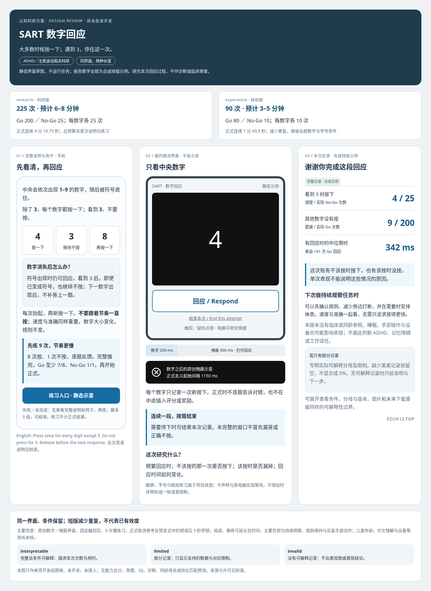

# SART 数字回应：原始图审与当前状态

最新状态：用户已明确批准开发，**内容候选已实现／未 DOT 代码复核／未接入**，见 [实施说明与验证原件](implementation.md)。以下图稿保留开发前图审档案，图中“尚未批准”不代表最新状态；次数与时长的测量精度仍未验证。2026-10-27。仅用于注意波动相关科研，不是 ADHD 或记忆障碍诊断、临床筛查已验证工具。

看到 1–9 的数字，除 **3** 外按一下；看到 **3** 不按。数字消失后还有一个短暂回应窗口，下一数字出现后不能补答上一题。例：**4 → 按；3 → 不按；8 → 按**。研究问题是：在频繁回应的连续数字流中，本次何时出现误按、漏答或回应时间变化；不是给人贴“注意力差”标签。

| 版本 | 正式次数 | 正式净时长 | 含首次说明、例子及练习的预计时间 |
| --- | ---: | ---: | --- |
| research 科研版 | 225：Go 200／No-Go 25；每数字 25 次 | 4 分 18.75 秒 | 约 6–8 分钟 |
| experience 体验版 | 90：Go 80／No-Go 10；每数字 10 次 | 1 分 43.5 秒 | 约 3–5 分钟 |

两版使用同一界面、数字／掩蔽和回应规则；短版只减少重复，仍保留全部九个数字和五档字号。时长是设计预算，非实测、非限时上限，阅读和重练可更长；短版没有已完成的效度或精度证明。

先完整说明和示例，再做 **9 次较慢练习**（8 次按、1 次不按，逐题反馈）；完成全部 9 次、Go 至少 7/8 且 No-Go 1/1 才进入正式。失败或未完成先完整重呈说明与例子，再练；最多 3 组，可结束。练习不计正式表现。这是理解规则的项目约定，不是临床阈值。

主要改造：文献基础上的独立手机／平板界面、单一固定回应区，保留鼠标／空格键；正式阶段连续呈现，不采用上游错误后 3 秒停顿、绿色情况反馈或段后注意评分。科研版借用论文计数及名义节奏，不宣称逐项复刻；字号、输入和练习均是项目变式。负担主要在单调持续观察、记住“3 不按”和反复手部动作。

报告用本次真实次数／对应条件分母、回应时间、简单解释和建议。图中所有数字均为**合成排版示例**。三态控制正文、图片及未来下载；缺失不填 0，不用总分、常模、IQ、诊断、同龄排名或岗位预测。中文理解、儿童年龄范围、设备等效和短版测量精度均未核。

深入核对：[来源、许可、协议与公式](sart-appendix.md) · [现有 24＋11 项去重](inventory.md) · [本次静态核对与交付边界](sart-review-evidence.md)。

**此为原始图审档案；后续开发已获明确批准。当前内容候选仍待 DOT 亲自复核，产品接入、集中测试、激活与上线未获本轮执行授权。**
