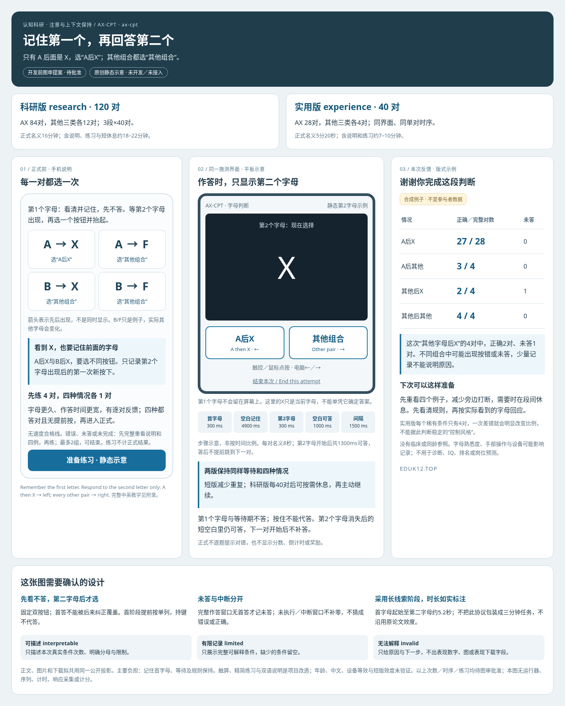

# AX-CPT：记住前一个字母，再判断

**单项图审提案r1，未获开发批准、未开发、未接入。** stable key提案 `ax-cpt`，沿本注意波动科研领域原AX-CPT WIP完善为这一份设计，不另起重复任务。2026-10-27（Asia/Tokyo）。

先看第1个字母并记住，等第2个字母出现后再选。只有“A后面是X”选左边“A后X”；其他所有组合选右边“其他组合”。**每一对都要选一次，首字母阶段不答；作答时屏幕不保留第1个字母。** 例如A→X选“A后X”，A→F、B→X、B→F均选“其他组合”。B/F只是例子，实际其他字母会变化。

| 提案 | 正式次数与条件 | 名义正式时长／预计全流程 |
| --- | --- | --- |
| research 科研版 | 120对＝84对AX＋AY/BX/BY各12对；3段×40 | 16分钟／18–22分钟 |
| experience 实用版 | 40对＝28对AX＋AY/BX/BY各4对 | 5分20秒／7–10分钟 |

两版同界面、输入和单对规则，短版减少重复并保留四种情况。每对名义8秒：首字母300ms＋空白记住4900ms＋第二字母300ms＋空白可答1000ms＋间隔1500ms。科研版每40对后可按需短休息，再主动继续；阅读、重练或较长休息会延长预算。

**先练4对，每种情况1对**，字母显示更久、作答窗口更宽；四种均正确首答且无提前按后进入正式，无速度合格线。错误、提前按、未答或未完成时先完整重呈中英说明与四例，最多两组，可结束。练习不混入正式分母。

主要改造：原创手机／平板字母界面与固定双按钮，触控／鼠标或←／→键；统一参考源码中不一致的键位说明，新增精简教学练习，不带入无关问卷或额外阅读计时判断。保留参考实现的长线索阶段，不把它包装成三分钟任务。原1999论文与此双按钮实现不是同一协议，不能借用原版效度；此变式不比较短／长延迟，也不据少量稀有组合判断“主动控制风格”。主要负担为记住首字母、等待与规则保持，中文、年龄及设备等效未验证。

图中反馈数字均为合成排版例子，不是参与者数据；报告只描述本次四类真实次数及限制，不给常模、IQ、诊断或岗位预测。[来源／分项许可、中英教学、首答／遗漏／中断与公式附录](APPENDIX.md)。这轮仅静态图审，未写运行器、序列或计分代码。
