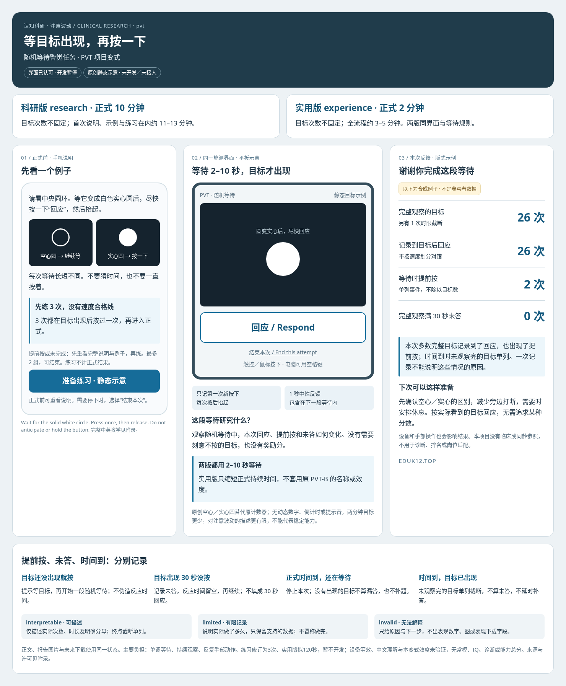

# 随机等待警觉任务 · PVT 项目变式

**界面已获用户认可；练习按用户要求改为3次。开发暂停，未开发、未接入。** stable key 提案 `pvt`；DOT 已确认本注意波动科研领域归属。沿原 PVT WIP 收敛为这一份单项设计；不另建 PVT-B 项目。2026-10-27。

看中央圆环，等它变成实心圆后尽快按一下，再抬起。不要猜时间或一直按着。研究问题是随机等待与持续作业时，本次回应、提前按和未答如何变化；不将它作为 ADHD、记忆障碍或疲劳临床筛查工具。

| 提案 | 正式次数与时间 | 首次说明、示例和练习在内的预算 |
| --- | --- | --- |
| research／科研版 | 连续 600 秒；实际目标次数不固定 | 11–13 分钟 |
| experience／实用版 | 连续 120 秒；实际目标次数不固定 | 3–5 分钟 |

本任务以目标出现到第一次按下的反应时为基础，同时记录提前按和未答；并非仅测一次最快反应。两版均不套用原论文的100／500／355ms分类阈值，120秒版是自定义短版，不能沿用10分钟PVT或PVT-B的效度。

两版同界面、同一单目标规则、同为 2–10 秒随机等待；实用版只缩短持续时间。无固定题数，不将论文中的平均次数当本项目配额。两版先做 3 次慢节奏练习，无速度合格线；3 次均在目标出现后新按下才继续。提前按或未完成先完整重呈说明与例子，再练；最多 2 组，可结束。120秒为本次讨论后的实用版修订方案，不构成开发授权。

主要改造：以原创空心圆／实心圆替代原计数器；固定大回应区，支持触控、鼠标和空格键的第一次新按下；1 秒中性反馈包含在下一段等待内；不响提示音。目标出现 30 秒仍未按，单独记未答并继续，反应时间为空，不补成 30 秒。正式时间到即停止：尚在等不算漏答；已经出现但未观察完的目标单列截断，不补零、不补答。按住、重复按键和同一次触摸不产生新回应。

原 PVT-B 同时改变了等待分布；本两分钟项目变式不能借用其效度。手机／平板、原创刺激与中文说明均未证明与原设备等效，两分钟版目标更少，对持续注意波动的描述更有限，主要用于简短了解任务；科研版仍保留600秒。短版数据更少，不推断稳定能力、疾病、同龄排名或岗位适配。主要负担是单调等待、持续观察及反复手部动作；需要时可结束。

[中英教学、边界、公式、来源许可及去重附录](APPENDIX.md)保留深入细节。正文、报告图片与未来下载拟共同受 interpretable／limited／invalid 三态控制。图中数字均为合成排版例子，未运行测试任务、未采集参与者数据。用户已明确要求暂不开发；此提交只更新设计，不改共享注册或产品接入。
