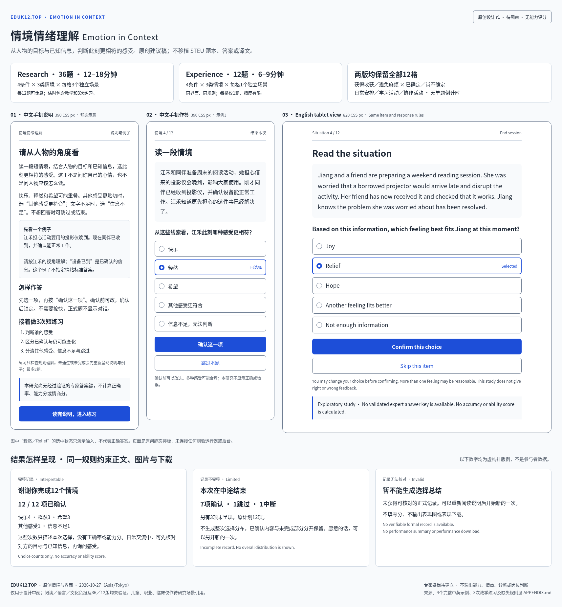

# 情境情绪理解：原创设计图审

**当前状态：暂缓开发。** 用户在完整文字稿交付后明确“暂时不开发这个”，原图稿和36题保留，不继续推进本项实现。其他备选见[本领域去重短清单](../ALTERNATIVES-20261027.md)。

**最新指示**：用户同意此图审方向，但要求先审阅完整文字场景，暂不开发。当前交付见[36题完整文字审阅稿](text-bank-r1/README.md)；下文保留图审提交时的历史状态。文字稿仍待review确认。

2026-10-27（Asia/Tokyo），设计r1。**用户同意原创方向，现提交细化设计；未获本设计开发批准，未实现、未验证、未接入。** 提案stable key：`emotion-situation-understanding`。此项当前是**不计算能力分的探索研究**；专家答案键尚未建立。

**简短实施介绍**：读一段原创人物情境，结合人物的目标和已知结果，选择此刻更相符的感受：快乐、释然、希望、其他感受更符合、信息不足；也可跳过。判断的是人物感受，不问“你会怎样做”，不作行为优劣或自评人格判断。先选再确认，确认前可改；首个有效确认锁定，不限速度、不显示正确或错误。

research **36题，约12–18分钟**；experience **12题，约6–9分钟**，均含首次教学与3次短练习，为设计估时。两版相同界面、说明、条件和响应规则：获得收获／避免麻烦 × 已确定／尚不确定 × 日常／学习／协作，共12格；长版每格3个独立场景，短版每格1个。没有在同一次任务反复改写同一故事。正式无单题倒计时；长版每12题可休息，短版在结束前不另插固定休息。

**教学与练习**：完整中英说明、示例和选项词义在正式前呈现。3个简短练习只检查人物视角、事实确定性、记录方式，不判情绪答案；3/3规则理解通过且完成才继续，最多2组。失败或未完成先重呈全部说明与例子；第二组仍未完成则结束，保留练习状态，不产生正式结果。

**主要细化**：增加“其他感受更符合”，与“信息不足”和“跳过”分开；明确选择后确认、无正确率、条件完整的36／12设计、缺失与中断状态，以及中英教学和三态报告。图中选中“释然”仅演示选中效果，**不是标准答案**。下方报告数字是虚构排版例，实际报告只能来自真实记录。

**限制**：词义、阅读经验、文化和情境熟悉度会影响判断；多种感受可能同时合理。没有专家键时，报告只描述本次选择和完成情况，不能评价理解能力、情商、IQ、诊断、同龄排名或岗位适配。12题每格仅1题，无法提供稳定精细的条件估计；36题也未建立信效度。成人科研优先，儿童／职业／临床仅待研究场景引用。

- [完整原创示例、中英教学、条件与报告说明](APPENDIX.md)
- [静态图稿HTML](review.html)（纯排版，无题库生成、事件采集、计分或运行器）
- [中文手机作答原图](phone-zh.png) · [英文平板作答原图](tablet-en.png)

原声音候选 `215e9bbd96769064723b38d8f594c6b07c03fa4f` 保留；本项不改共享注册、平台、权限、schema或COS，不启动CI、合并、部署或激活。
