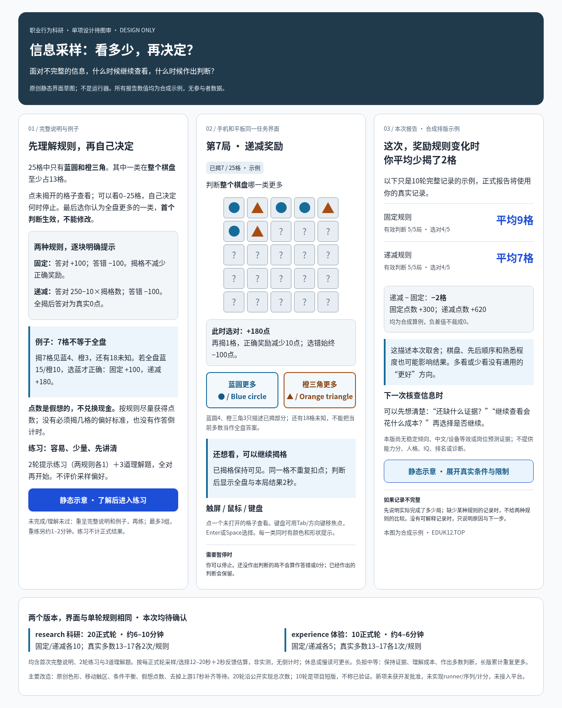

# 信息采样：20/10轮内容候选，未DOT复核、未接入

2026-10-27。用户已明确批准“四个认知都同意启动开发”，本项按已审图片实施。独立分支`cognitive/domain-occupational-20261027`，基线`a0130ea6603d7e37fd4f900d8694b5b7d490c51e`。本次只交付信息采样；不混职业领域其他四项WIP，不改PR363、共享注册表或其他领域。

每局25格，自选揭格量后判断整个棋盘的多数。research20轮、约6–10分钟；experience10轮、约4–6分钟；固定/递减各半，均覆盖多数13–17，长版每个条件2轮，短版1轮。两版单次规则/界面相同；2轮较易练习＋3理解题，全对理解后进入正式；中断或未完成/未理解先重呈完整中英说明与例子，最多3组。不按点数、正确采样量或偏好过关。

蓝圆/橙三角及48px触区沿图稿原创；蓝圆按钮固定左、橙三角固定右，与图一致。seed使多数身份与正确侧别在块内尽可能平衡：长版各半，短版5轮只能3/2且两块互补，不能声称短版每个细条件左右都平衡。首次完整激活判断锁定，重复揭格不加成本；无判断为空，真0、负奖励和负差值保留。假想任务点不兑换现金，短版/中文/设备/岗位效度未核。

已实现独立协议/冻结参数/seed计划、React候选、中英教学/原始事件、权威scorer、后台描述报告和白名单公开投影。公开正文、可选一张小图和JSON下载共用三态；没有内部指标直出、能力总分、常模、IQ、诊断、同龄排名或岗位预测。保存失败停止呈现，重试同一原件及最终声明，不重新曝光；完整原件归档与报告回执不混为成功。

DOT定向收尾已补冻结教学语言与首屏普通中英叙述，并修复StrictMode replay永久dispose的问题；当前配置/呈现0.1.1、测量协议/计分0.1.0。旧0.1.0报告保留原呈现，不重算。[本轮修订与证据](information-sampling-implementation/review-followup.md)。

审阅入口：

- [实施说明及边界](information-sampling-implementation/README.md)
- [后台内容定义](../../../../../server-version/backend/src/modules/cognitive/content-candidates/information-sampling/package.ts) · [权威scorer](../../../../../server-version/backend/src/modules/cognitive/content-candidates/information-sampling/scorer.ts)
- [实际React候选](../../../../../server-version/frontend/src/modules/cognitive/tasks/information-sampling/IstTask.tsx) · [完整中英教学](../../../../../server-version/frontend/src/modules/cognitive/tasks/information-sampling/IstInstructions.tsx)
- [公开报告/图/下载规则](../../../../../server-version/backend/src/modules/cognitive/content-candidates/information-sampling/report.ts)
- [本地检查原件与来源绑定](information-sampling-implementation/validation.json) · [科研20轮合成原件](information-sampling-implementation/research-example.json) · [该合成公开报告](information-sampling-implementation/research-public-report.json)
- [来源许可](information-sampling-sources.json) · [实际取用通知](../../../../../server-version/backend/src/modules/cognitive/content-candidates/information-sampling/NOTICE) · [24旧项目和11已有候选去重](dedup-index.md)

本地定向检查是未签名开发证据，不是正式CI、真机/四入口或科学效度。未启动全App/旧测验/集中测试、CI、合并、部署或激活。用户允许本项单commit `[skip ci]` 推职业分支供DOT读取，不是主内容分支放行；汇入认知分支及原PR360由DOT复核后统一安排。
