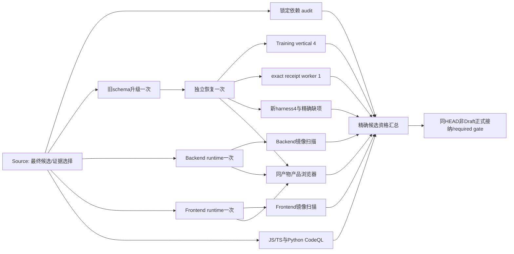

# PR356 修复收口与合并资格接线（待独立审查，未激活）

> 当前状态：已接入16个独立 phase、Q 汇总、admit 预检、稳定 required gate 和 main 入口；Ready 只观察、不走宽路线。全部 ready/历史 approved/SARIF policy 仍 pending。B精确调用点经新独审授权和实际审批接入A，三组实际reader/CLI合成控制通过；gate/main只读官方aggregate/Q及固定原phase元数据。正式资格与激活仍待审。下方小步是各次事实记录；最终完整HEAD/tree/base在提交后实读交付，旧锚点不代表当前候选。没有激活 CI，不能合并。

> 实施阶段小步①：新增固定PR356入口检测及真实legacy CLI的Ready/main拒绝，7个直接控制契约通过，原件见E A157–158。仅此防护已实现；下方其余计划仍在接线。新控制路径使58c43e22阶段的旧冻结不再代表当前中间提交，最终完成后重新列全差异、逐名control及完整head/tree/base。未运行应用检查/CI，没有Ready/合并/部署；本小步不是可激活候选。

> 实施阶段小步②：独立backend/frontend image与audit执行器、实际工作树输入核对、官方FROM digest固定、官方run/job/attempt/artifact ZIP验证及统一stage已实现。原35/6与新增定向控制结果分开保留，stage首轮失败与仅失败两例复验均有原件；未执行真实API、构建、审计或应用。YAML及最终资格链仍接线中，历史未接纳，冻结尚未重做，不能激活CI。

> 实施阶段小步③：六个隔离DB phase执行器及actual exact-lazy consumer已实现，升级/恢复/vertical4/worker1/ordinary四库/当前exact child分别独立。新exact脚本真实服务链与冻结身份已有静读，控制stub增量通过；未执行PG/迁移/应用。原NOT_IMPLEMENTED交接原件保留，新状态为实现完成、实际资格NOTRUN；当前仍不能激活CI。

> 实施阶段小步④：同一已验证 dist 的教师 COURSE 精确组合选择/提交、GENERAL 边界、Survey 普通逐题及 exact 冻结空指导语消费者脚本已实现；原状态页四场景保留。fixture 仅载入编译 runtime，使用独立 schema 与受控短会话，真实 HTTP API 透传；私人材料不入产物。仅语法和直接 fake 控制分批通过，原调用/过滤/旧失败均保留；实际 PG、浏览器、应用、CI 全部 NOTRUN。精确组合的非空指导语 seed 尚无批准来源，不冒称覆盖。YAML/required gate 接线仍未完成，本提交不能激活。

> 实施阶段小步⑤：两语言真实 CodeQL Action metadata collector、原 SARIF 完整性/全部 finding 保留、显式 disposition 模块已实现。共享摘要 helper 只处理已认证摘要的处置，不认证原件、官方来源或独立人审。仅假 CLI/Action 和新增直接拒绝契约执行；没有实际 CodeQL/扫描/CI。upload:never 的分析成功仍不能替代 finding 处置，历史接纳与最终放行继续 pending。

> 实施阶段小步⑥：单镜像 Trivy 消费者保留真实 JSON、当前 HIGH/CRITICAL ignore-unfixed 策略和原 producer 图；入口 pure NUL diff parser 不再反向导入旧路由；独立 producer 显式 upstream=[]。仅5＋3＋1个对应纯控制用例分开通过，没有实际 Trivy、Docker、构建或CI；原同输入绿项未重跑。

> 实施阶段小步⑦：完整16 phase/13历史组与 source 输入表、官方 Q/预检/稳定gate/main 接纳核心已实现，所有 ready/approved/policy 状态仍 pending。Q 保留完整 finding 待处置，admit 保存精确 review；独立只读 A 以实际 Q ZIP 建 WeakSet 根、固定17 role元数据及原 Q 过期状态复核，直接4项＋新增精度/状态2项分开通过。**A 未接入 CLI，当前下游仍会重新下载原 phase ZIP，轻量 main 能力尚未完成。** 原整块重写经自动审批拒绝且未执行；B 仅有可审阅 patch/说明，状态 pending，未应用或执行。原件索引包含该补丁字节，不能把提案称已实现。

本轮先修复普通整卷测试的隔离/输出接入缺陷，再提出可执行的合并资格收口设计。**下述新接纳、分阶段作业、真实产品浏览器、required gate 与 main 复用均为待审实现，不是当前工作流已具备的能力。** 当前 `qualificationOnly=true / mergeEligible=false` 保留，不能只翻转这两个布尔值取得合并资格。

用户要求每个完成小步一次 commit/push，使用 `[skip ci]`；最新 dot 接管边界要求每轮 CI 之前独立审查全部修复和计划，并对最终完整 HEAD/tree/base 明确放行。未放行前不 dispatch、Ready、rerun 或推送会触发 CI 的提交。继续现有 PR/任务，不新建替代 PR/对话；不改 main、保护规则、长期凭据、安全设置或生产配置，不部署。

## 1. 候选身份与执行事实

设计比较锚点为 `c064b38eb6ef68517e5a3861072cf3dc055da978`（tree `aa64f8f228bfe3b10a4e756b317839a1d46fb758`），base/main `ff8471e529e7b3c56e1e20f17d1e2581040fc896`。dot 已独立核对该锚点完整 351 路径（340 source＋11 control）、blob/mode、两组件树、保护输入及 213 份原件的 bytes/SHA。这些事实不等于业务验收、历史输入完整证明或正式 CI 通过。后续测试修订使旧 source 冻结失效；本页末尾另列实际新产品提交及最终控制提交，不能用 c064 身份替代它们。

PR 保持 Open/Draft，未合并；本轮尚未激活 GitHub Actions，累计正式 CI 失败轮次仍为 0。所有本地红轮、filtered、continuation、verify-only、缺失原件继续保留。验收目标始终为 `PR356-merge-qualification`，换 SHA 或改称“限定验证”不重置失败累计。

root 读取 `branches/main/protection` 被 integration 以 HTTP403 `Resource not accessible by integration` 拒绝，状态 **denied**。没有重试绕过或新增身份。现有代码/先前实读记录为 required `merge gate / ready PR`、strict up-to-date；当前远端保护状态须由具有现成读取能力的 dot 独立核对，本节点不冒称已重新验证。

### 本次已推送的产品身份

| 输入 | 实值 |
| --- | --- |
| 产品提交 / 父提交 | `862c324be459c6ab6f0daabb4798034388c0410c` / `c064b38eb6ef68517e5a3861072cf3dc055da978` |
| 产品 tree | `6048b438ff682c3928e0e9152fb51ee4b47af57a` |
| base/main | `ff8471e529e7b3c56e1e20f17d1e2581040fc896` |
| backend / frontend tree | `ff7edd58e3824178075aaaf74730e2fa2367a5fe` / `87590586f2902baf14f0a94e8d444ac9e4b2e7e8` |
| 严格差异 | 342 source＋11 control＝353路径；两新增路径仅test harness/helper contract |
| main→产品的NUL raw差异 SHA-256 | `6a073eb15e656d070faa6ed8a77bcab61e1961e5f231b60a71c467d5244a0738`（包含产品提交时的control字节，不冒充下一控制提交raw摘要） |
| bindings SHA-256 | `274587659e8ffdb5863c252c9c72fd7dbdb31c98eb85c4826d5d440eef2b9b19` |

最终控制提交的完整HEAD/tree/远端PR merge preview在提交后实读并于对话交付；任何后续CI实现/fixture/控制变动均产生新的最终候选，须重新独审，不能拿本次“设计提交”激活将来不同代码。

## 2. 修复对照与仍须证明的直接消费者

| review 目标 | 当前源码收口 | 证据边界与本方案处理 |
| --- | --- | --- |
| 普通 SCALE Survey 指导语、Completed/null、独立物化 | 精确来源读取；新快照冻结文本或 null；完成态复用冻结投影；纯指导语修订可更新物化 | 既有适配/PG/投影原件逐项接纳；新增同 dist 真实逐题浏览器补实际页面消费者 |
| Training 整卷/当前单元刷新 | 优先冻结 runtime/CONTENT 指导语，保留旧字段缺失的兼容读取 | 不以单元 DTO 测试替代真实回执/worker旅程；现 vertical/worker缺口单独执行一次 |
| 原精确委托被后任入口角色替代 | 存储 DELEGATED 依据直接校验原 grant，不经优先角色分支；入口管理员合法发行仍保留 | 保留原 72 case 与不相交修正 case 的原调用身份，审实际 authority/callee 闭包；不重复整文件 |
| 已开始独立 FINAL、School/Teacher/Questionnaire/ORG 边界 | 以持久来源/principal 区分新 START/重启和已入场 FINAL；保留应有的当前 emergency 策略 | School/Teacher PG START/FINAL 与后续 restart 是不同 invocation，不合称 fresh 全套；按原件逐 case 处理 |
| 普通/教育组合创建 child | 两个真实调用者显式传已有 composite，不再假设 Prisma scalar attempt 自带关系 | eager 两例原报告保留；后续源漂移按分支审相交性，不因整文件变化自动全部重跑 |
| 普通与精确 lazy 冻结候选 | resolver 原对象的 WeakMap proof 绑定同 tx/parent/epoch/current item/scale；exact 通过 HISTORY 核完整精确身份 | ordinary实际 child.create 与 exact resolver/HISTORY 十三例分别保留。exact 上游真实接线的实际 child 消费者尚缺动态证据时，只补此一条，不重跑十三例 |
| durable ACK 后下架/停用、租约等待 | 新 ACK 同事务核 selected child/source 与停用；已接受 single/batch 仅在真实 receipt/hash/epoch/slot/context/当前 lease 下完成；等锁后重读实际 UTC wall clock | single/batch绿色是既有 ACK 后恢复，不冒称fresh；新隔离harness另有编排目标；原 mock八例和真实PG锁等待是不同证据 |
| ordinary ACK 资源路径 | 始终传 collection callback；普通整卷即使 atomic flag=true 也进入安全事务 callback，不使用旧无callback单语句路线 | 旧 atomic SQL/性能数字不再代表此候选；见356-01最小观测设计，保留安全修复 |
| 成人纵向 | 使用真实冻结年龄；缺失年龄不可解释；同set混合adult/school精确阶段过滤；兼容性核阶段与各时间点生效日 | 成人三例原12输入/argv/exit较强，旧十三例另审，不借新receipt追认旧执行 |
| UTC/历史报告/组合审批/状态查询 | UTC无时区窗口；报告schemaVersion显式边界；范围幂等冲突；实际产品审计；分页/批量状态读取 | 九个opt-in逐case原件/漂移/缺证映射见附录，不重新跑九套凑资格 |
| Teacher C/P/R、GENERAL、分页父测试、producer attempt | COURSE 精确组合选择/POST/冻结summary；GENERAL native边界；旧URL mock已修；consumer使用原producer run/head/attempt/artifact | unit通过不等于教师网页可用；真实同产物浏览器补缺。现attempt修复不解决同job内部半成功，下一节明确拆分 |

## 3. 历史证据的接纳设计与缺失项选择

`.github/scripts/pr356-evidence.mjs` 当前只证明原字节/计数完整，明确 `qualificationClaim=false`。README 的既有历史接纳白名单属于另两个固定 Mac 候选，不能自动扩张到 PR356；文档/工具 Ed25519 通道也不能补签应用历史。

拟增加**仅本 PR 精确候选、逐 invocation/case 的 reviewed-historical-local 清单**，先交 dot 审查后才实施。每条包含原 reporter/case pointer、原命令与 exit（未知保留未知）、原失败/过滤/continuation、可取得的原源码/fixture/schema/lock/工具记录、旧→新mode/blob和实际传递闭包判断、当前适用范围及审阅 digest。历史项恒为 `ciExecuted=false / originalExecutionSigned=false`；不得写成原执行时已有完整manifest。可接纳 failed invocation 中确实 passed 的独立case，不能授予整条命令/teardown成功。

原完整 node_modules/tool字节未记录者如实披露；不得借另一 invocation 或后来七文件diagnostics补签。dot 没有明确接纳的项目仍是未接纳。缺少 argv 但有真实 reporter 可讨论case，不得改成完整命令通过。确有源码变化则审所走分支/import/shared state/config/schema，不按文件名一刀切；无法确定影响的具体case才列缺项。

优先取回**已经存在**的原件；bibliography与Survey10case本节点有原raw和部分退出记录，随本轮保真打包。connected旧八例raw/log/migration/Prisma本节点缺失，不能用摘要重建。完整矩阵见附录A；现有25+57 reporter/131附件的原身份不变。

确定需要新执行的最小集合为：

1. 干净 backend/frontend runtime各构建一次，Backend Dockerfile内已有production `tsc`；不再额外运行一次同输入后端编译。
2. 230→237带真实旧FINAL/加密报告的升级、当前读回、dump/restore、追加不可变约束一次；与功能fixture准备严格分账。
3. 当前源码下完整 Training vertical四例与真实exact receipt worker一例，零skip/零continuation/零verify-only。旧部分执行不能拼成这两个完整调用成功。
4. 教师C/P/R保存刷新、GENERAL边界、Survey普通非空逐题、exact null无live泄漏，同一已构建dist/backend runtime的一次窄浏览器consumer。
5. 新ordinary四旅程隔离harness的**新编排目标**：fresh四独立DB且全文件一次执行、每旅程独立客户端/队列/ledger、受控证据目录。拟在唯一隔离PG作业一次无过滤执行4case；这是改变fixture/模块/数据库/队列输入后的新完整编排资格，旧分库过滤证据不能证明它。原single/batch worker与prestop/lockwait开发结果仍保留，不能改称本次执行或重新分别过滤各跑一遍。当前只运行无DB的新harness合约；整文件PG执行留给经dot放行后的这一处。
6. exact lazy 的上游真实参数→resolver proof→guard→实际child物化尚缺动态消费者证据，拟仅补一条合法已入场exact flow的真实消费者（普通准入撤回后仍完成当前冻结单元；已有负例资格单独接纳），不重跑已通过的十三个guard合同；fixture须真实来源/冻结身份，不用sentinel提前结束。
7. 其余附录case只在原件无法恢复、dot未接纳且确属必要、或真实消费者输入变化时，加入逐case缺项清单；每个目标只有一个主要位置。清单必须在最终激活前固定；不支持仍有“待定”就运行以试错。

前端 app types/lint 原exit与输入需逐项核验；有足够原件即接纳。若缺证且确实必需，只在独立前端缺项作业各执行一次，不能默认把原整套test/pretypecheck也带上。audit基于锁/工具/漏洞库时效及官方来源，不借旧无时间来源记录宣称当前扫描。

### Git内原件读取位置

全部在 [pr356-local-evidence.json](../.github/scripts/pr356-local-evidence.json)，每条 `rawBase64` 解码后按 `sha256`/`bytes`核原字节；`portableRawIndex`给精确JSON pointer。原213项逐对象/原字节均保留，没有改挂候选或更换成功状态。新增原件不等于已审接纳。

| 原件 | 精确pointer | 原身份 |
| --- | --- | --- |
| 新harness最终report/命令退出 | `/followupReports/58`、`/followupAttachments/132` | 30PASS/0skip；FS＋fake clients，无PG |
| 窄types初错/修后退出与日志 | `/followupAttachments/137`、`/138`、`/139`、`/140` | exit2保留；修后exit0仅helper/unit，空green log有实际receipt，不扩大scope |
| 三文件syntax、fresh/replay未来命令 | `/followupAttachments/136`、`/135` | syntax检查不是PG；命令示例NOTRUN |
| 旧bibliography轴3例 / PG4例 | `/followupReports/59`、`/60` | 恢复原raw，原日志/readback在A141–144；空types无推定exit |
| 旧Survey10例 / 原exit / 原runner / migrate log | `/followupReports/61`、`/followupAttachments/146`、`/147`、`/148` | 原survey exit0、同driver training exit1均保留，不相加或覆盖 |
| 后端逐case完整研究 / 浏览器详细fixture设计 / CI详细设计 | `/followupAttachments/149`、`/150`、`/151` | 三份只读设计文档，不是运行结果 |
| c064旧激活计划原字节 | `/followupAttachments/152` | 历史计划保留，不覆盖成新路线已实现 |

connected旧八例所指原raw/log/migration/Prisma在本节点仍MISSING；新取回的Survey/Bibliography原件不能补它，也不补造不存在的历史输入manifest。

## 4. 实施后的作业拓扑与唯一产物

拟将 `qualification.py` 当前两个串行大模式拆为显式phase，不默认“rerun failed jobs”可复用一个失败job内部的成功段：

Backend与Frontend各独立producer，分别即时上传自己的image archive/inspect/log/阶段receipt。Frontend另输出同runtime提取的dist与逐文件hash。两扫描分开，不因backend扫描失败而丢frontend结果。升级、恢复、vertical、receipt worker分成独立job；新harness/具体PG缺项若选中，也各自有明确fixture/setup/执行/cleanup和report，不混入共享全库。

升级job完成后立即上传仅合成旧数据的custom dump、事实/模式指纹与输入receipt；独立恢复job在自己fresh PG还原，核当前reader/append-only后再输出仅新schema及`_prisma_migrations`元数据的受控setup artifact，供新合成库初始化；不把复用schema setup当再次升级验收，不复制旧应用账号/私有DB dump。runtime消费者缺Prisma CLI/npm时用该setup schema，在已构建镜像内require编译服务，不再build/安装backend。来源schema、migration checksum、PG版本和artifact必须绑定。

每phase原件至少记录：实际命令/exit、selected case精确列表/数量、零skip要求、测试/fixture/导入源码/config/schema/lock/tool/生成物的执行前后输入清单、敏感env名称及安全值类别、run/job/attempt/head/base/tree、日志/reporter SHA、镜像ID/archive SHA、distmanifest与setup身份。新执行使用当时真输入；这不追认任何历史运行。

## 5. 部分成功、重试与 main 复用

**同run consumer失败：**通过官方API读原producer job/steps/artifact ID/name/head/run/attempt/digest，使用首次成功producer的实际attempt，不能拼当前attempt名称；缺产物先停止。producer成功不重建，消费者只补失败目标。外部dot仍须对每轮激活的精确候选及计划放行。

**producer/job内部部分成功：**拆job优先消除backend成功/frontend失败以及upgrade成功/vertical失败的重复。job内若build成功但save/upload失败，当前没有可证明原完整archive即视为不可复用；保留build结果，停止，不承诺通用rerun。只有原archive/完整manifest确实已上传且当时对应phase真实完成时，才可走明确的官方artifact phase接纳。不得用缓存命中或临时tag替代资格。

**跨run/跨HEAD：**只接纳清单固定的官方源run/job/attempt/artifact，逐phase核完整消费输入及工具闭包。控制/证据文档变化并不自动使组件产物失效，但任何控制变化都使旧dot放行失效；实际业务/fixture/tool变化只使相关phase证据失效。未实现跨run adapter前明确停下，由独审制定定向续跑，不调用全量fallback。所有失败原job仍保留failure。

**main事件：**仅当真实before=固定base、after已合并tree与最终候选/合并身份一致、完整diff路径/mode/blob及protectedInputs相同，并可核官方资格与产物receipt时，走轻量post-merge接纳，不再编译、扫描、浏览器或运行DB资格。绑定实际合并父链/树，不能只信PR号或commit message；未知main差异/来源缺失停止本窄路线，不默认拉起全平台。上线仍独立授权，本方案不自动部署。

## 6. 稳定 required gate 的合法资格链

实施范围必须同时覆盖 `content-scope.mjs`、`pr356-scope.mjs`、`merge-gate.mjs`、`ci.yml` 及相应路由/拒绝契约，保留 required 名称 `merge gate / ready PR`、strict和所有选中项非success拒绝。现 `merge-gate` 排除该dispatch且不知道PR356，不能靠改结果job名解决。

拟分两阶段，均限原PR分支及最终完整候选：

- **qualification**：可在Draft下执行唯一一轮已批准缺项，生成官方不可变qualification receipt及原件；明确它自身不能合并。
- **admission**：仅在同HEAD已非Draft且已有完整合格receipt时运行轻量官方接纳；重新读取PR/main/merge preview，重算完整checkout/tree/rawdiff、全部case/phase输入、官方run/job/artifact及安全审核结论。缺失、fail、cancelled、skip、Draft、base推进/merge tree漂移都失败。稳定gate真实依赖source＋admission及被选中的安全结论，不接受把其它route的skipped汇总视作成功。

`[skip ci]` 下Ready事件是否创建所需check不能猜。实施时选择一个确定性支持的手动 **admission-only workflow_dispatch** 分支，使用现有Actions权限、同一个ci.yml及稳定gate名称，明确指向已完成资格run。Ready本身及任何dispatch仍是需要dot精确放行的激活动作；不能同时用无skip push/Ready/dispatch三路试探。若Ready触发了既有pull_request事件，该路线只能做同HEAD的轻量官方接纳，不能重新运行资格生产者。自动入口与manual必须共同fail closed，不回legacy。

外部dot在此任务对完整HEAD/tree/base的明确审查放行是程序性边界，不伪装成repository variable、dispatch自报SHA或本节点自审证明独立批准。正式admission在所有必需审阅（含SARIF实际结果和原范围合并判断）完成前不会成功。无需新secret、变量写权限或保护例外。

## 7. 同一产物的真实产品浏览器

保持现`pr356-browser.mjs`状态页四个viewport/theme断言及synthetic UI身份，新增真实产品consumer（Chromium，预算15分钟未实测）。两个已验证runtime归档＋同frontend dist＋独立PG/Redis；fixture运行镜像内编译服务。白名单测试origin的静态页面可沿现安全context桥接，API透明转发真实loopback backend并保留method/body/Origin/Cookie/CSRF/Set-Cookie/status，未知网络失败；不mock成功、不新增证书trust或忽略TLS验证。此证据不认证生产ingress/真实登录MFA。

| 新旅程 | 合法准备与实际页面/HTTP | 必须检查 |
| --- | --- | --- |
| Teacher COURSE | 现有非HOLD注册源，正常install/publish/preview/approve三次trial，两组同C不同P/R（含none-v1），真实use grant/course/草稿 | 两组合可区分；精确pointer单次POST、无caller authority字段；保存后完整reload取真实GET，冻结summary/DB身份一致 |
| Teacher GENERAL | 同teacher独立GENERAL草稿，合法native Scale真实授权 | COURSE组合不显示，native真实添加保留；直接发exact pointer被拒，revision/item不变 |
| Survey普通非空 | 合成owned普通SCALE指导语，真实grant/import/freeze/open，浏览器consent/start-unlinked/task | 默认ONE_BY_ONE note；freeze后改live文字，resume仍原文；真实FINAL/receipt唯一，answers不夹指导语 |
| Survey exact当前null | 正式批准精确组合的CONTENT无指导语，正常SURVEY准入/导入/冻结 | 后改live Scale行不泄漏到task/逐题DOM，恢复/FINAL完成；只证明null冻结 |

真实系统session/CSRF可沿既有合成fixture准备，token/entrySecret/accessCredential/cookie/password不上传，HAR/答案/DB dump不作为公开artifact。正常批准的两组合首次明确TRAINING/SURVEY scope，不用不同scope幂等重试偷偷扩权；不得直写ONLINE或trial成功。

当前40正式注册源均无`source.instruction`，且没有正式轴写API；已有非空exact合同只在内存CONTENT metadata上构造。故“exact非空registry→approve→浏览器”仍缺真实正式内容，不用上述null旅程或contract冒充。备选仅为**经dot明确采用**的未批准synthetic CONTENT metadata seed，再走真实批准/冻结/消费，证明persisted轴输入合同而非registry内容验收；不加生产hook/伪工具/新量表批次。默认不执行备选，NFC10正式内容范围见下一节。

## 8. 安全结果的接纳

两runtime按现有HIGH/CRITICAL阈值扫描，保留扫描器/数据库版本、imageID/archive SHA、完整exit/report；一端失败仍收另一端原件。依赖audit含开发依赖，官方源与锁保持。

CodeQL保持security-extended JS/TS与Python完整分析；`upload: never`只避开当前不可用上传端点，不意味着零发现。正式接纳必须检查：两语言预期SARIF确实存在且可解析、工具/CLI/querypack与配置身份、提取/分析完成且无错误/取消/部分结果、每个实际result的rule/severity/location/fingerprint及原SARIF SHA。零result只是结果事实，不可将空文件/缺run误认无发现。

没有仓库现成通用“SARIF为零才通过”规则，不能擅造新阈值或把runtime HIGH/CRITICAL套到CodeQL。按既有安全标准和dot独审核对实际findings：未审查的相关安全发现保持未处置；已有baseline只有真实可核原件才可比较。审查/处置记录绑定最终候选、语言/querypack、SARIF digest与逐result，保留原结果，不删除告警。分析job success本身不能独立授予安全资格；该结果审核完成后才允许admission。

## 9. 原承诺范围与356-01：不能静默删项

来源为本轮已读的Notion[统一路线图](https://app.notion.com/p/403d27635a388157aa34c83821491347)（观察版本2026-10-26T04:05:04.134Z）与[剩余开发验收](https://app.notion.com/p/405d27635a388174b2d3c82e2968dfd4)（2026-10-26T05:39:05.547Z）。它们的旧HEAD是历史范围来源，不是当前候选成功证明。原①～⑥平台件已有实现/定向结果，按真实闭包接纳；不从零重做，也不把平台通过升级成内容批准。

| 原项 | 当前边界 | 有限完成路径/合并判断 |
| --- | --- | --- |
| NFC10/OPT10等正式指导语与正反内容验收 | 平台冻结已接；正式内容/非空来源验收未自动完成 | 由原内容/独审责任人提供既有批准的精确版本与原件；仅补对应原工具的必要消费者。来源未获准不得用synthetic正例消除内容缺口，不新增量表批次 |
| PHQ9/PCL5/PC-PTSD-5 | HOLD保持，不注册/分发 | 维持原HOLD；是否属于本次可合并的隔离内容由dot按真实批准范围明确，不能开发者删项或激活它们 |
| 完整Training纵向和获准P/R | 当前四例有合法发布/FINAL/父完成/冻结轴与教师受限报告负例设计，完整当前执行仍缺 | 唯一fresh vertical四例补当前路径。教师按冻结披露返回UNAVAILABLE是正确负例，不能称获准READY正例；若原合并范围需要额外获准P/R，使用真实允许的既有audience/模板/数据授权一次补该消费者，不能改开放策略或抬研究者标签补绿；先冻结合法fixture与预期 |
| 356-01与UD-08 | 旧d01/main31d9及atomic路径数据为历史，当前callback ACK没有新基线 | 先按下方单次cold/hot/SQL观测完成受影响普通Training路径；Training/Survey普通混合、长问卷、SJT、正常/恢复全部原分组依旧单列，不能称这一个样本完成整个356-01 |
| MOT/认知后续、新内容批次 | 不在本轮新增范围 | 不接入、不扩验收，不借合并目标带入新功能 |

### 356-01本轮最小观测设计（仅计划，未执行应用检查）

真实路径为 `submitWholeQuestionnaire` → selected child/source同事务callback → `registerWholeQuestionnaireReceipt` 的事务callback分支；`ASSESSMENT_WHOLE_ATOMIC_RECEIPT_ENABLED=true`也不会走仅在`!assertCollectionAllowed`时启用的`registerWholeReceiptAtomic`。这项变化是为停用与新ACK的同事务边界，不能为恢复旧性能路线删除callback。旧atomic性能/SQL基线不得接纳为当前候选。

在UD-03正确性通过、最终source与runtime固定后，使用已有原356-01合法普通表单＋量表fixture，**仅一个cold进程旅程＋一个同输入约定的hot配对旅程**，串行、无并发发压。各用新participant/attempt/receipt，冻结相同版本/定义/答案协议及配置；warm只在同进程已初始化后运行，不能重复提交已settled作答冒称新hot。发布/fixture成本单独记录，不混入每被试。

主要位置拟为已建runtime的独立`pr356-baseline-observation`消费者，复用相同backend产物、setup schema和锁定fixture，不再build。首次仅观察普通Training受影响callback路径；原Survey/长/SJT/恢复分组保留对应状态和输入，后续只按dot确认的真实合并缺项执行，不自动还原原80次/六型harness或并发容量测试。

现`runtimeObservability.ts`的`PERF_ISOLATED_TEST_MODE=1 + PERF_SQL_EVENT_COUNT=1`只计数/耗时，不能声称它已有SQL形状/来源。沿已有隔离SQL观察器（例如vertical中的事件分类）在**测试专用wrapper**记录脱敏模板/调用来源及阶段，不改生产metrics发原SQL。按START、保存、FINAL/ACK、worker持久化、父聚合、报告生成/读取分段；同SQL事件只归一阶段，总数另列，事务控制与读写分别统计；健康/observer/setup查询另账，无法归因仍unknown。触发器/锁/计划成本不等同应用SQL条数。

记录前台durable ACK、父完成/报告就绪的完整边界，API/worker各自CPU、RSS/heap、HTTP请求数/字节、SQL次数/形状、所需存储行/逻辑字节。PG CPU/IO、峰值锁或wire字节若工具不可得明确unknown，不写0，不推算吞吐/P95/百分比收益。callback新增安全读锁成本按原实际SQL列出；不能把转移到worker/发布的工作当净减少。

预算：reuse/setup≤2分钟、cold/hot两旅程及排队完成≤4分钟、汇总/收证≤2分钟，**8分钟上限且尚未实测**。只有已确认正确性的这两个有界样本；超限保留原件并停止诊断，不加并发/预热样本。该观察不认证容量、生产WAN、完整356-01所有分组或新的性能收益。

## 10. 实施顺序、适用清单和预算

1. 本轮先提交测试harness窄修及新harness合约原件，保持skip-ci；重新冻结完整source/blob/tree，不放宽未知路径。控制计划和历史原件保真移交另一步。
2. dot先独立审阅本设计，确定逐case历史接纳/具体缺项、原内容/P-R/356-01的真实合并范围，以及非空exact synthetic轴备选是否采用。未经明确选择的方案不默许执行。
3. 经设计确认后，实施本节列明的CI控制/fixture/接纳适配器及必要测试路径修订，仍skip-ci；只做变化控制脚本/拒绝契约、嵌入脚本语义和actionlint，不重跑已合格应用目标。每个new执行前记录真实输入，禁止历史补签。
4. 产品/fixture稳定后重新固定完整base/head/tree/rawdiff、两component tree、schema/锁/工具、逐case选择、预算、官方来源及全部未执行项，交dot独审。此时所有控制变更也属于最终HEAD，旧放行不继承。
5. 仅收到对应最终完整HEAD/tree/base放行后激活既定qualification路线；无合格官方结果不Ready/合并。结果与SARIF实际findings/原范围审查完成后，dot另行协调同HEAD非Draftadmission与真实required gate；不自动部署。

拟改控制：`ci.yml`（phase与admission/main窄入口）、`content-scope.mjs`/`pr356-scope.mjs`（精确事件/范围与main）、`merge-gate.mjs`（稳定required真实依赖重算）、`pr356-qualification.py`（独立phase/输入receipt/schema setup）、`pr356-evidence.mjs`（保持observations身份并接纳已审清单）、明确PR356历史/官方phase接纳器及fixture/browser脚本。新增控制路径一一冻结并独审，不能借整目录白名单。可能必须修改的测试仅限hosted隔离/输出fixture问题，改变的测试输入另列新资格位置。

| 作业 | 上限预算（待实测） | 重试/复用单位 |
| --- | --- | --- |
| source、历史/官方接纳与控制拒绝 | 5分钟 | 精确候选/选择清单；source失败停止消费者 |
| 两端audit | 8分钟 | 各锁/工具/漏洞库身份，独立保留两端报告 |
| schema升级 / 独立恢复 | 12分钟 / 8分钟 | 各独立官方phase，恢复后输出setup schema |
| vertical4 / exact worker1 | 各12分钟 | 独立job/旅程，不重跑已成功前序 |
| ordinary新harness4 / exact lazy实际消费者 /具体PG缺项 | 各5分钟；历史条件缺项的总预算激活前固定 | 新编排与逐case目标分账，保持原报告 |
| backend / frontend producer | 各25分钟 | 各自runtime archive与dist，成功后不重建 |
| 两runtime扫描 | 各15分钟 | 对应imageID＋scanner数据库身份 |
| Chromium状态页＋产品四旅程 | 15分钟 | 同两产物/fixture/实际选择场景 |
| CodeQL两语言 | 各30分钟 | 原SARIF/查询包/语言的独立结果与审查 |
| 356-01单cold/hot观察（若已选） | 8分钟 | 已构建产物＋固定两旅程输入 |
| result / admission / 稳定required汇总 | 3分钟 / 5分钟 / 既有8分钟 | 官方原件验证，不执行应用检查 |

这些上限不是耗时承诺；当前旧拓扑source5＋images25＋scan15＋result3已有48分钟临界链，不能声称5分钟全绿。新拓扑并行生产者缩短部分串行等待，实际下载/排队另计；超过5分钟报告正在等的具体阶段，不盲重启。

激活前再次读取[Notion CI清单](https://app.notion.com/p/404d27635a388186ac80de3593da05a5)，按真实变化筛选22个ID（不是22套必跑测试）。本方案直接涉及001隔离套件、002控制语义、003类型工具、005独立DB、006准入、008产品浏览器、009完整回执、014 SAST、015–017浏览器环境、018原范围、019证据保真、020精确授权与正式接纳及LOCAL-001/002编码/哈希域；其它条目保留不适用理由，不为清单凑全量。

如真CI失败，固定run/job/attempt/SHA/首错/原件/未执行下游，定向归因修复；**再次激活之前**按用户已授权写回同一Notion错误页并读回，保留旧失败/维护人/权限。写回denied/pending/uncertain先报告核实，不绕过不重复新建。相同目标连续两轮失败不收敛停止继续整轮，换SHA不重置；同产物不重建，只有实际实现且独审允许的phase续跑才执行。

## 11. 本轮实交与未执行

本轮交付是测试接入修复、可读原件与待审合并资格设计；不宣称上面的新CI接纳已实施或已成功。尚未运行正式Actions、生产构建/扫描、真实同dist产品浏览器、带旧数据升级恢复或356-01应用观察；没有合并/部署。新测试合约的实际命令/结果及最终Git身份随本次提交记录核对，原业务旅程不因方案研究重复执行。

### 本轮新增控制核验与原件总量

已在稳定产品862上重新生成严格binding，未改任何workflow或门禁实施。仅执行被新source清单直接影响的两条candidate允许/拒绝契约，2 PASS/0 FAIL；另外六条未变控制合同未选，不冒称本次8/8。新执行的实际Node版本/二进制SHA、命令/退出、4个直接控制输入前后SHA与日志在A155–156。actionlint的YAML输入本轮未变，保留原合格证据，不重复执行。

原件当前共244项＝原25 reporter＋62 followup reporter＋157附件；这是原件数量，不是通过断言总数。原213项逐对象/字节保持。新A153为产品freeze receipt，A154为main→862完整NUL raw diff（SHA见产品身份表）；A155–156为实际新2条控制契约日志/退出，均无CI资格声明。最终HEAD实读校验另由对话报告，不把自引用HEAD写进自身commit。

## 附录A：逐invocation/case及原九套opt-in的输入映射

以下保留只读研究原文，以c064为比较锚点；测试harness之后的变化与新的唯一执行位置以上文为准，不能将原文“当前hash相同”跨到新测试源码。原文提议取回的Bibliography/Survey raw已在F59–61和A141–148保真取回，connected仍缺失；不因此改写原执行的输入边界。所有“可接纳”都只是待dot逐项审阅的候选，没有脚本自行授予资格。

# PR356 backend 证据接纳研究（只读，候选 c064b38）

本研究读取了 `c064b38eb6ef68517e5a3861072cf3dc055da978` 的源码、Git 内证据、原日志/receipt 和现存 scratch 原件；没有运行任何测试、类型检查、构建、签名、数据库或 CI，没有修改产品或工作流。下面“当前 hash 相同”是本次只读比较，不是事后给原执行补造 source manifest。dot 已复核 351 路径/213 原件的字节完整性；这与每次执行的输入身份是两个结论。

## 规则及可用机制

- 根 `AGENTS.md` 两条铁律要求：本地已实际成功且消费输入仍同的检查不复测；输入变化只处理受影响项；不默认“本地全验再 Actions 全验”。`docs/release/README.md` 是唯一维护来源。
- `.github/scripts/local-validation.mjs` 的 `recipes` 只有 `documentation`、`release-tools`。现有 Ed25519 签名通道不能签 PR356 app/PG/类型历史，不能新增一个签名后声称原执行当时已认证。
- `docs/release/README.md` 的历史本地接纳有既有设计：独立审阅原 reporter、原失败/过滤项和传递源码闭包，绑定确切 attestation digest，标 `reviewed-local-evidence`、`historicalKind=reviewed-historical-local`、`ciExecuted=false`、`originalExecutionSigned=false`。但现有授权/实现明确锁两个 Mac 最终候选，不能宣称 PR356 已享有自动接纳；其中 Cognitive 35 case 的额外缺工具原件例外也不能直接扩大到 PR356。
- 可行方案是提请 dot 独审一个 **PR356 精确候选、逐 case、明确环境局限的历史接纳清单**，复用上述机制的原件/闭包审阅形式。此研究不等于该清单已获准。不能修改原锚点 48516ef 或把所有 reporter 改挂当前 HEAD；不能把 failed invocation 变 success；不能把源码后置快照写成 contemporaneous manifest。
- 当前 `.github/scripts/pr356-evidence.mjs` 只验证 retained-development-observation 原件与计数，输出 `qualificationClaim=false`；不验证每份 app report 的执行命令、源码闭包、schema、工具/生成物、数据库状态，也不授予 required gate。
- 无原件的历史字段不能补造。可以取回**已经存在**的原工具调用/终端退出、原 runner 脚本、原 schema/fixture 日志、原 lock/tool 安装记录，再独立审查；如果当时没记录源码 hash，必须仍写缺失。不能以当前 tree、另一 invocation 的工具哈希，或晚些的诊断 receipt 代替它。

## 定位约定

`E` = Git 内 `.github/scripts/pr356-local-evidence.json`。
`R<n>` = `/reports/<n>`，`F<n>` = `/followupReports/<n>`，`A<n>` = `/followupAttachments/<n>`。
这些对象的 `rawBase64` 解码得到原字节；原报告的具体 case 使用解码后 `/testResults/<suite>/assertionResults/<case>`，下表明确 suite/case 时按此路径定位。原对象上的 sha256 只证明原字节没变。

`V` = `docs/evidence/library-management-next-20261025/validation.json`。
`H` = `docs/evidence/library-management-next-20261025/followup/`。
`T` = `docs/evidence/tool-onboarding-next-20261025/training-standard-flow-validation.json`。
`D` = `docs/evidence/pr356-standard-dual-entry-20261026.json`。

命令分两种：表内 `A.../command` 是现存原 argv；“候选 recipe”只是将来经授权补缺时的建议，不证明历史曾用同 argv。所有相对 `src/...` 的 cwd 为 `server-version/backend`。

## 直接受影响检查矩阵

| 检查与实际原件 | 原命令 / 退出及结果身份 | 原输入边界与当前比较 | 可接纳范围 / 最小补齐 | 唯一位置与预算 |
|---|---|---|---|---|
| 7-file durable ACK/exact flow diagnostics：A23，日志 A22 | `/command` 为说明性文本 `TypeScript options/global plus selected file syntactic/semantic diagnostics; no emit`；exitCode=0、errorCount=0；Node24.21/TS5.9.3 | 7 个 `/sourceSHA256` 均与当前相同：outbox、whole、collection guard、unified FINAL、composite、flow scope、standard collection。没有原完整 executable argv/脚本、tsconfig/import .d.ts/Prisma 生成客户端/lock/tool 字节闭包 | 只能保留“7 个选中文件零诊断”的实际观察，不能改称 whole-program tsc 或干净生产构建。先恢复原诊断脚本/工具记录如存在；即使恢复，也只接纳原 scope | **不额外重跑 tsc**。真正缺失的 clean backend 编译已在唯一 images builder 的 Docker `npm run build` 最后执行 `tsc`，随同一次产物构建留阶段退出；既有 images 总上限25分钟 |
| 更早 17-file diagnostics：A9/A8；单文件补充 A11/A10；3-file child diagnostics A13/A12 | A9/A11 无精确 argv，均 exit0；A13 仅描述性 command，exit0 | A9 当前12/17字节同，5不同；其中 frozen instruction 仅EOF格式差异有A47明确before/after，另外4是后续实现变化。A11 scale-start 源仍同；A13 的 composite/flow/guard 三源全已变化 | 不把17+1+3+7相加成全程序类型资格。各保留原 scope/源码身份；发生真正源码变化的原诊断不能全局继承；EOF可审阅为无语句变化但不能修写旧hash | 同上，不新增重复诊断/tsc任务；旧日志仍保留 |
| 成人年龄、混合参照、阶段转换：F0（13/0/3）、F3（3/0/13）；旧F1/F37和R2不重复计入 | F3 原argv在A4：`node node_modules/vitest/vitest.mjs run src/__tests__/assessment-reference/scale-wave1-longitudinal.test.ts -t 'adult population-specific reference effective dates' --reporter=json --outputFile=...adult-window-dates-green.json`；exit0。F0 无独立打包 argv/exit receipt | A4 的12个原inputSha256当前全部相同；运行时TS闭包为 test/fixture→longitudinal/reference-binding→reference/governance/canonical/context，type-only imports擦除；这些源码、Vitest config、package/lock均已记。此纯函数路径无PG/Prisma/registry要求。原Node版本有记，原Vitest/TS/Zod实际字节、node_modules全清单未记 | **最强窄历史接纳候选**：先审F3 suite0 cases13–15及A4/A7；披露工具/依赖历史边界，不能称全环境认证。F0 suite0 cases0–12分开恢复其原调用与时间/输入联系，再审13项；不能借A4直接证明F0 invocation。红F2/F4仍失败 | 优先独审接纳，0测试重跑。若某case缺证无法补且dot明确选择新执行，只该缺失case在一个开发/Actions位置一次，预计10–30秒；不重跑已接纳的另外13/3项 |
| 冻结原21B严格委托：F18、F9；早期F13为旧输入 | F18 实际72 PASS/1 FAIL；F9 只修文案对应case6 PASS/72 filtered。原精确argv/退出未独立打包为receipt，默认日志见A41/A21 | F18 旧case0..72含5个“后来任entry admin也不能替代原root”负例；F9只覆盖case6。源码 authority/use/source fixture 已有当前SHA在A9，但A9是诊断那次的输入，不是两次测试的 contemporaneous manifest；不能借用其时间身份 | **可审的73个不相交历史case集合**，不是一次73绿。恢复原工具/终端命令/退出及已有源记录后，对原67/新增5/文案1分别审 imports、fixture、锁后时钟、scope/callee。早期68不替代后续strict实现。若闭包某块未知只保留该块gap，不重跑全部73 | 首选窄历史接纳，0执行；确认缺证且获准时仅缺的委托分支，在合成定向unit或既定PG生命周期位置之一，unit≤30秒 / PG≤2分钟 |
| C/P/R choices与教师冻结summary：F8 suite0 case73，F45 suite0 case74；日志A20/A97 | 分别1PASS，73/74 filtered；缺原完整命令/exit receipt（原工具调用在本对话可作为有限恢复来源，不能伪称已在E中） | choices由已授权SQL只投影三版本标量；summary严格decode/hash后只回instrumentVersion+三版本，不查当前权限。两例不测试真实teacher保存/浏览器或真实DB签发 | 可逐case审read-only DTO/隐私，恢复现存工具记录、核新增case与老73不相交。不能因当前hash同推定原source完整 | 优先历史接纳，0重复unit；正式teacher浏览器消费者另缺、与本unit不同目标，复用唯一dist，非本backend研究执行项 |
| 指导语冻结/Completed/独立物化/精确组合来源：F19 与 F20；旧R14/R13保留 | F19 为9PASS/1FAIL的原失败invocation：suite0 case0–6 + suite1 case0–1实际通过；F20 suite0 case2 1PASS/2filtered。原命令/退出未独立receipt，日志A42/A43 | F20已修exact来源fixture读取错的元数据位置；不能把坏fixture首轮当生产失败。真正源码 frozen instruction/schema/helper在A9等有后置/另次hash，缺这两次完整closure。指导语为空和历史缺字段的兼容必须分开；不能用函数正文同忽略schema/callee变化 | 可审9+1不相交case集合；不将F19改成success。恢复原工具/记录后审schema移位是否严格同合同、CONTENT reference元数据和runtime envelope消费。若缺证只补对应exact来源case，不重跑7个老instruction cases | 首选历史接纳；必要新缺项在一个定向unit/PG来源位置，unit≤30秒 / 来源PG≤2分钟；默认不执行 |
| 独立量表实际START恢复/重启返回指导语：F39，A91/A90 | A91 exact argv：`node node_modules/vitest/vitest.mjs run src/__tests__/scale/standalone-instruction-envelope.test.ts --reporter=json --outputFile=...standalone-instruction-envelope-green.json`；exit0，1/0/0 | scale-start原hash当前仍同；test hash后续仅EOF空行变化，A47给出明确before/after。没有完整contemporaneous closure；此例不是PG授权/投产启动资格 | 可审实际controller返回投影的1case；EOF兼容用独立diff说明，不改旧receipt。不能用原带runtime抛错sentinel的失败报告补此绿色结果 | 历史接纳优先；无必要复跑本case；真实PG权限另见School/Teacher，不能把同一UI文本目标再跑一遍 |
| School/Teacher合法START、Training新START拒绝、已入场FINAL：F16；历史红F12/F14/F17 | F16 2/0/0，日志A37；原run-entry脚本在A85但不是命令执行receipt；A9等不是这次测试的run-bound输入 | 真Prisma和正式controller，测试session由fixture读取真实DB principal后注入，**没有测试完整登录/MFA ceremony**。原早期自报realm fixture缺陷与生产改动分开。collection/FINAL后续ordinaryACK分支有变化，须按无receipt/standalone实际callee审对本两例影响 | 优先恢复原工具退出与schema/5-user fixture日志A35/A36/A85后，逐例审当前改动对执行分支是否不相交。不能因全guard文件变就全失效，也不能因standalone函数未改忽略共享guard | 首选有限历史接纳。若仍有缺失，唯一专用隔离PG/HTTP仅2case，运行约10秒、含迁移准备预算≤3分钟；不追加整个账号生命周期 |
| 现有已入场ordinary emergency/shared边界：F36（两文件11pass）、F10（新增1pass/8filtered） | 无独立argv/exit receipt，日志A87/A24。不是PG真实账号链 | F36 scale-governance suite0老8case + publication suite1 3case；F10对新entered emergency case单独通过。guard后续加入ACK/proof只在相应scope时走，须审测试mock/actual调用是否仍同，不得只按文件名豁免 | 可提出逐case不相交历史接纳；保留最后F10新增位置，不将11+1当同一invocation。没有实际PG源指针/竞争证据的部分不升级为PG资格 | 首选历史接纳；必要缺例单个unit≤30秒；已经覆盖的School旧单元不重跑 |
| School/Teacher重启新准入及emergency：F15，A33 | F15 1/0/0；A33 exit0，但明确 continuationOnly=true、只给testSourceSHA256，缺完整原argv/生产source/工具闭包 | 保留先前F16五人/一量表/一次完成的真实库；这1例新增restart/stop矩阵，不重新执行原START/FINAL。测试后来新增第6用户，不能再按五人fixture假装fresh全套 | 只接纳该continuation实际新断言，不能称三case一次全部通过。先恢复原工具记录及依赖早期已接纳fixture事实；缺失时不能重置库假装原执行 | 首选历史接纳。未能接纳才设计一个fresh最小restart/stop场景，PG≤2分钟，不重复原START/FINAL资格目标 |
| 普通eager COURSE/ORG scalar parent：F5；A16，日志A15 | A16 exact `vitest run src/__tests__/composite/pr356-child-parent-shape.postgres.integration.test.ts --maxWorkers=1 ...` exit0，2/0/0；原schemaSHA记录653352...，Node24.21 | test/hash/schema仍同；A16记录的composite/flow/guard三个生产源已从cc5/5cbc/2ffc变为046/4f1d/90f6。后续差异涉及exact lazy proof和ordinaryACK，并非这两个eager/ORG分支自动失效的证明 | 先按当前 `createChildRecords(db,attempt,composite,...)` scalar修复、ORG shared guard及无proof/无receipt分支审相交性；若证明2个case实际闭包不受后续差异影响，可窄历史接纳。缺当时全部imports/Prisma client字节须披露，不能A16当完整环境签名 | 首选独审，不先复跑；确有相交缺项时只相应1case，专用PG≤2分钟 |
| ordinary lazy proof/current unit：F26（11/0/1）；实际child消费者F24（6/0/4）、F25原失败中指定通过项 | F24 argv/exit0在A49：`vitest run .../training-flow-materialization-reuse.test.ts -t 'rejects (hash|candidate epoch|candidate parent|publication) mismatch|reaches the actual lazy guard' ...`；F25 exit1在A51，不能全通过。F26缺单独argv/exit receipt | A49/A51的composite/flow/guard已真实变化，test最终hash仍同；F26原报告仅11case，不含最后“caller parent/item claim”case。应精确区分旧测试在runtime读取前故意停止的局部观察，和F24已真实guard+child.create后再停公共projection的执行边界；均不是完整HTTP/PG学生链 | 可审F24六个实际case，以及F25中**不重叠**且callee证明未受影响的指定pass；不能相加5+6或声称10全fresh绿。ordinary shared emergency仍须保留。先审actual分支、proof原对象/tx/epoch/单unit、当前exact扩展对ordinary branch是否无行为影响 | 历史接纳优先；仅真变动/缺证case在该单元唯一位置补，≤30秒；不重新执行所有flow消费者/科学回归 |
| exact lazy flow：F22 / F23；日志A45/A46 | F22 13/0/0；F23 13fail均setup blockKey不符合真实schema，已只改fixture为scale_0/1。原精确argv/exit未打包receipt，可从本对话原工具调用有限恢复 | 真加密resolver、真frozen runtime/parent content binding、真HISTORY；没有抛错runtime sentinel。此测试直接调用standard collection，**不证明root后来补的composite→guard第6参数接线实际跑过**；没有完整当时closure，不能用A23后来的7源码hash追认 | 可窄审13个boundary case（current+伪造/复制/跨tx/parent/epoch/future/expanded+sourcehash/measurement/axis）。需另静读当前真实接线，若要求完整lazy child写入证据，只补这条未曾执行的实际消费者，而不是重复13个guardcase | 13case优先历史接纳，0重跑；真正缺失actual exact lazy child消费者，在唯一隔离PG/HTTP一次，≤2分钟，先设计fixture和输入receipt |
| ordinary ACK single/batch：F33/F28；A77/A65；保留红F34/F29+A79/A67 | 各1PASS/2filtered；原argv分别 `vitest run src/__tests__/composite/pr356-ordinary-receipt.postgres.integration.test.ts -t 'processes accepted single|batch' ...`，两receipt exit0 | 两者用不同专用库，A83/A84是先前ACK后写的真实synthetic ledger；绿色执行发现已有ledger会从“已接收、stop已发生”状态继续，**没有重新执行fresh ACK/旧budget锁互斥那一段**。原argv/exit/report绑定明确，但两receipt无run-time生产source/schema/tool清单 | 这是各自已持久化ACK后的真实worker/父完成/同payload回放证据，可提窄历史接纳。不能说“绿色single/batch两次都fresh完整含ACK”；ACK前置段须结合原红执行时已完成的明确断言、ledger原件及caller/注册事务unit证据独立审。无原件不能拼成单次成功 | 优先审现存原件与ledger关系，0重跑。仅缺失的fresh入库ACK位置或某worker分支需要补时按case选，PG约20秒、含fresh准备≤3分钟；不是默认single/batch全套重跑 |
| ordinary pre-stop拒ACK：F31，A72；红F32/A74 | A72 exact `vitest run ...pr356-ordinary-receipt... -t 'rejects a new ordinary whole submission' ...`，exit0，1/0/2 | 新场景调用fresh合成fixture、先真实stop再register；断言job wholeSubmission/answers仍null、WAITING、无完成child。A72无run-time生产hash/工具清单；A76为schema迁移日志，不能自动指定它是所有invocation同schema | 可先恢复现存run-ordinary脚本A86、原工具退出/同库迁移路径/源码记录（若有）；保留独立1case，不把它包装为另一次worker成功。当前实现当时hash不能由A23追认 | 首选历史接纳；确证缺失才仅prestop一次，PG≤2分钟 |
| real lock-wait→lease过期：F30，A70；日志A71 | A70 exact argv：`vitest run ...pr356-ordinary-receipt... -t 'rechecks wall-clock lease after a real job-lock wait' ...`，exit0；1/0/3 | A70的outbox源95a610...和test33f879...当时before/after记录、当前均同；真实job行锁、pg_stat_activity见等待、确认开始等待时lease有效、等待过期后拒绝且0child写。未记录完整source/tool/Prisma/schema闭包；此调用不是整个worker流程 | **较强历史接纳候选**：审exact真实锁/lease断言和outbox相关callee，拿原schema/工具记录如存在；不能以单case代表所有single/batchlease路径或整个PG suite | 优先窄历史接纳，0执行；若确实缺相关新分支只补那个case，实测约19秒，PG≤1分钟 |
| outbox receipt/lock/budget八个定向case：F54、A107；红F55/F56、A109/A111 | A107 exact argv选择两个测试文件、8个正则分支，exit0。F54 suite0 case11 + suite1 case0..6（8pass/13filtered） | A107三输入hash当前同且sourceUnchanged=true；真SQL由mock事务观察，没有PG竞争。分别覆盖等锁后时钟/完整live binding/缺或变binding、detached callback不触full旧budget、legacy permit/满队列拒绝、锁后manifest变化拒绝；缺完整原import/config/tool字节 | 可优先审8个新断言；不复跑未变的13项，不把mockSQL断言当真实lock-wait/PG ACK成功；和F30/F31/F28/F33是不同目标而非重复全链 | 首选历史接纳。有限恢复receipt外原工具数据；如有真缺失仅新case在一个unit位置≤40秒，不再叠加相同PG目标 |
| 当前完整Training vertical与actual receipt worker：R19/R18、R15/R16/R17 | R19 2pass/2fail；R18 1pass/3filtered；actual worker R16 fresh失败，R15 continuation worker曾到READY但后置存储断言失败，R17仅verify-only1pass | 这些不是当前正常完整4case+1case的成功；精确授权、native仅SURVEY/组合TRAINING矩阵、later-role撤root、source freeze、receipt fence均有实际后续输入变化；current source也已变 | 此项是**已明示缺失的完整受影响旅程**，不由旧部分/继续/verify-only相加替代。保留旧事实身份，不重建旧成功结果 | 既定 `pr356-database` 唯一位置：fresh vertical4 + fresh worker1（零skip），与一次230→237升级/restore共≤20分钟；单阶段成功后后续失败须停整job rerun并设计只补缺项 |

## 七个diagnostics的具体输入

A23 `/sourceSHA256` 七项全部与c064当前一致：

- report-outbox.service.ts `95a6102c...`
- whole-questionnaire.service.ts `74857844...`
- scale-collection-guard.ts `90f6937e...`
- unified-final-submit.service.ts `f101517c...`
- composite.service.ts `046daae0...`
- training-flow-scope.ts `4f1d4e69...`
- training-standard-collection.ts `ef446502...`

原完整hash保留在A23，不在研究中重写。相同只是七份源字节事实，不能推出未记录imports、compiler options、生成.d.ts、锁定工具当时相同。Backend Dockerfile确实在 `COPY prisma` 后generate、COPY全src后 `npm run build`，其最后是全production tsconfig `tsc`（tsconfig排除tests）；因此**缺的是唯一干净构建的实际成功，不是要再加一次同输入独立tsc**。

## 原九个 opt-in 的逐项选择矩阵（条件型，不是九套全跑清单）

| suite | 原件精确位置及退出边界 | 原输入/fixture缺口及当前影响 | 先恢复/独审；仅有缺项时的selection、位置、预算 |
|---|---|---|---|
| content-grant-time.postgres | E:R24，解码 suite0 cases3–5，3PASS/3filtered；原docs/evidence/pr356-review-fixes...`checks[3]`同摘要；原runner仍在 `/workspace/scratch/pr356-review-utc/run.py`，不是独立exit receipt | 只实际测 shared library delegated UTC/AsiaTokyo/LosAngeles新增3例；前3个root/delegate场景被过滤，不能称6绿。actual临时表/UTC TIMESTAMP触发器/usage.ts闭包与schema迁移需审；没有这次完整历史tool/fixture绑定 | 取回已存在原command/终端退出和专用库迁移记录；先审shared库usage改动与UTC迁移。缺失只选3timezone相关目标；不能因原套件有6就重跑未影响前3。唯一专用PG临时表连接，测试实测约6秒、准备预算≤2分钟；必须显式设置CONTENT_GRANT_TIME_TEST_DATABASE_URL |
| training-standard-connected.postgres | T `/reports/6`（4passed）、`/reports/7`（2passed/4filtered）、`/reports/9`（2passed/6filtered），case元数据及原report digest存在；原raw path为 `/workspace/tool-onboarding-combination-flow-...json`，不在E的213原件中；已逐一核对T reports6/7/9及migration/Prisma/对应logs路径，本节点均MISSING。T `/realSqlHttp`清楚限定8个不相交断言 | 当时APPROVED_WITHOUT_TRIAL合成源；不是合法ONLINE学生纵向。T `/directChangedInputsRecordedAfterExecution` 明确后置hash；authority/use/outbox本轮真实变更，原8项必须逐callee审。`PERF_ISOLATED_TEST_MODE=1`、`PERF_SQL_EVENT_COUNT=1`必需；afterAll固定写`/workspace/...setup-trace...json`，Actions现成执行不能假定目录可写 | 先仅从原节点/已存在归档尝试恢复raw8case及原命令退出/trace/fixture schema（本节点已知缺失，不能假设可取到或用摘要重建raw）；将原21B/SQLNULL/不可变reuse/RAW回放各目标划定。无证或新callee相交只执行该缺case，不能以当前vertical又覆盖就再跑整个8case。唯一隔离PG/HTTP，≤3分钟；先解决trace输出目录和suite fence，不靠skip过关 |
| bibliography-axis.postgres | `docs/evidence/pr356-bibliography-axes-20261026.json` `/reports/1`仅4pass摘要/digest；原raw现存 `/workspace/scratch/pr356-step3-evidence/postgres.json`，尚未在E原件内；实际case0..3可恢复 | sourceSnapshotRecordedAfterExecution只有3输入；当时synthetic registry provider，不授予ONLINE/真实科学资格。当前materialize instruction-only分支有变，不能只说axis-snapshots正文同就接纳4项；需审只改citation/report/reference时是否仍无定义/指导语变化 | 先保真打包已有raw及原命令退出/数据库readback；审原provider/lock/schema/tool。可接纳未受影响case；若某materialize分支确受影响且缺证明，只对应case在fresh bibliography专用PG一次。环境flag PR356_BIBLIOGRAPHY_ISOLATED=1，namedDB/port55439守卫、空schema；≤3分钟 |
| catalog-discovery.postgres | Git raw `docs/evidence/library-management-next-20261025/reports/backend-unified-1.json` `/testResults/2/assertionResults/0,1`两pass，原整invocation12pass/1fail。`backend-new-retry.json` `/testResults/1/assertionResults/0`另1pass但与前报告case0重叠，不累加；V `/invocations/7`保留失败 | V `/sourceManifest`是handoff后置，不能作原run-bound；有Node archive hash、PG16.15镜像digest、官方npm ci+Prisma5.22记录，但需关联具体invocation。当前八维字典/discovery/sql过滤内容相对当时有变；按cognitive条目31/UNKNOWN engine与精确STANDARD join两个case分别审。该suite是describe+全局beforeAll，未设URL会setup失败，并不是自动skip | 先审原raw+V现成toolchain、imports/registry字典、原lock。两个目标若一个相交只补那一个。唯一临时表PG，显式LIBRARY_DISCOVERY_TEST_DATABASE_URL（其代码要求任务loopback postgres库URL格式），≤2分钟；不再次跑整个目录unit集合 |
| catalog-instruction.postgres | E:R10，suite0 case0 1/0/0；R9/R11两轮失败保留。docs/evidence/pr356-review-fixes...`checks[1]`是集合摘要，无原argv/exit receipt；原log/runner如存在可恢复 | **必须克隆已有five-user/one-scale synthetic vertical fixture**，不是empty新库。通过正式publication/grant/import/freeze/public task读取指导语，但非真实浏览器。当前exact CONTENT instruction改动不自动影响普通SCALE适配，但需审实际catalog.sources分支、runtime-null边界、schema/helper的传递变化；不能用unit手传instruction代替本case | 优先恢复原调用/fixture provenance/schema/client记录并窄审旧真实链。确有缺项才只该普通来源1casePG/HTTP，PR356_INSTRUCTION_ISOLATED=1，≤3分钟。需获准的已知基线clone/备份，不能重跑完整vertical来造同一证据、不能随意改ONLINE或删除stop |
| library-management.http | Git raw `H/http-final.json` `/testResults/0/assertionResults/0..4`，5pass；`H/summary.json /results/httpFinal/commandExit=0`，27request/0server500；`http-journal-final.json`实际路由/状态，`http-final-inputs.sha256`含原test/lock/schema；`http-type-only-equivalence.json`及`http-before-nonnull.txt`保留两非空断言的原/新和TS/esbuild等价输出hash | 原test 7d38...→68f149...的两type-only更改可审，不能据此全盘作废。旧schema9793...与当前653352...真实不同；原保护函数清单/后置manifest仅当时范围，不涵盖后续预算/entry变化。需逐case审所读列、auth/limits/metadata路径与完整source import初始化，不能把31个SUBMITTED不完整metadata当真实onboarding/授权 | **强原件历史候选**，先用现存journal/inputs/toolchain/schema迁移差异作逐5case审阅；优先接纳不相交case。需要补只读/分配哪条实际变化就只该case，唯一隔离HTTP/PG/Redis，≤3分钟；不重复登录/MFA ceremony、全目录或状态页浏览器 |
| onboarding-pagination.postgres | E:R23 suite0 cases0,1实际pass，但invocation2pass/1fail；E:R22 suite0 case2 1pass/2filtered，HTTP继续仅补最后一例。不能称两个invocation是一整次3case绿 | 原HTTP续跑需要122个Scale的已保留synthetic fixture，normal需five-user/one-scale原clone；保留原规模/fixture语义。当前status函数如未变仍须审preview/deployment reader/registry与auth route传递变化；“SQL4次”不代表生产压力测试 | 先取回原具体命令、statusHTTP继续开关、fixture/schema/工具证明；逐case接纳2+1不相交事实。真缺case仅它在专用PG一次（PR356_STATUS_ISOLATED=1，续跑必须如实标PR356_STATUS_HTTP_CONTINUE=1，不能称normal）；≤3分钟，不再做全系统性能 |
| standard-approval-scope.postgres | E:R6 suite0 case0 1/0/0；无独立原argv/exit receipt。旧legacy intent unit另R4 5pass，不能替代PG | 克隆five-user且已有ONLINE/source approval event的synthetic baseline；当前approval service原入口范围幂等+审计修复已在本case目标内，后续CONTENT metadata/registry版本仍需审原frozen triplet及sourceParts。已后置snapshot不当当时完整manifest | 恢复原调用/库clone记录/approval行和事件来源、工具/schema；如果仅某新来源影响scope输入，补该scope case一次即可。唯一PR356_APPROVAL_ISOLATED PG，≤3分钟；不要重新试跑全部Trial/Training来生成同一qualification |
| standard-triplet.postgres | D `/reports/2` 10pass摘要/digest；raw现存 `/workspace/scratch/pr356-step5-evidence/survey-integration.json` suite0 cases0..9；原run-dual-entry.py、dual-entry-exits.json现存，已读survey exitCode=0（独立training记录exit1不改写），可保真取回。该原raw尚不在E213集合 | D明确sourceSnapshotRecordedAfterExecution，原test/source当时内容可从记录恢复但不能声称完整。当前approve intent、instruction schema/content metadata、旧报告版本/预算等有真实传递输入变化。10case包含SYSTEM/entry否认/session/MFA/CSRF/origin/3trial ONLINE/no-grants、freeze→FINAL、none P/R、withdraw历史；它们各消费不同闭包，不应以一个下层文件变使所有case重跑 | 先取回原raw+exact argv/exit/合成fixture/state/schema/tool。对10case做变更相交映射，保留未影响认证/read-only拒绝类，只有受影响的approval/FINAL/instruction下游case可进入补缺selection；不能直接默认全10重跑。唯一SURVEY_TRIPLET_ISOLATED隔离PG/HTTP，子case预算30–120秒，fresh准备总≤5分钟；正常suite若状态串联，须设计不重复已接纳case的合法fixture入口，不能强改ONLINE |

## 最小设计输出，不立即执行

1. 给每个拟接纳case明确原report pointer、原selected name、原invocation status/exit（未知仍未知）、原source/fixture/lock/tool记录、当前对照及真实传递变化。优先从本节点**现有**原件取回；只做元数据/源码审阅，不先重跑应用。
2. 将可审的历史case绑定为窄候选review清单，状态是“待dot独审接纳”，不是E verifier自己生成成功。仍保留原的失败、filtered、continuation、verify-only、署名缺失、环境字节缺失和source manifest后置事实。
3. 对每个无法恢复的字段说明影响：缺exit但有真实case reporter可仅审case，不能审完整command；缺runtime工具身份不借别次hash；有源码实质变化只选实际callee相交case；没有证明变化影响时继续静态审，不默认全跑。
4. 只有已明确缺失的clean backend产物、当前完整vertical4/worker1、旧schema230→237升级+restore，以及独审确认不能历史接纳且确属必要的最小case，才进入将来唯一执行位置。所有这些选择仍待候选精确独审，**本研究不触发它们**。
5. 如果任一长job部分成功后后续失败，保留所有阶段退出/产物digest并停止整job rerun；当前driver没有通用分阶段续跑，不能承诺已有。真实CI错误才写Notion，不把本地fixture红灯改写为Actions事故。

本研究没有为历史证据补签，没有修改现有锚点或qualificationClaim，没有跑9套opt-in，也没有新增“先本地全绿再CI再全绿”的步骤。

## 本节点现存历史原件恢复（新增scratch附件，未改Git原证据）

`B` = `/workspace/scratch/pr356-historical-recovery-bibliography-standard-triplet-c064.json`。B只携已存在原件的未改字节，逐项含originalPath、bytes、sha256、rawBase64和来源身份；稳定key/pointer见B `/portableRawIndex`。此打包不是执行、签名或历史source manifest。现有E的213原件未修改。

| 本文矩阵项 | 新稳定原件pointer | 独立保留的缺口 |
|---|---|---|
| bibliography PostgreSQL四例 | B `/artifacts/bibliography_postgres_report`（解码cases0..3）、`/artifacts/bibliography_postgres_log` | 原argv/runner/process-exit receipt未记录或未找到；不能把reporter4pass改称原命令exit0 |
| bibliography另外三unit例、数据库元数据readback、原输入记录 | B `/artifacts/bibliography_axis_contracts_report`、`/artifacts/bibliography_database_readback`、`/artifacts/bibliography_existing_input_record` | 原输入仍明确是sourceSnapshotRecordedAfterExecution；无contemporaneous完整工具/传递闭包 |
| bibliography空types日志 | B `/artifacts/bibliography_types_empty` | EMPTY，0字节，不证明types成功，不授予原进程exit0 |
| Survey standard-triplet十例 | B `/artifacts/standard_triplet_report`（解码cases0..9）、`/artifacts/standard_triplet_log` | 待逐case影响闭包独审，10pass不变成当前候选的整次正式CI资格 |
| Survey原runner、原退出、schema模板日志、原后置输入记录 | B `/artifacts/standard_triplet_run_script`、`/artifacts/standard_triplet_exit_record`（解码`/survey/exitCode=0`，`/training/exitCode=1`原失败保持）、`/artifacts/standard_triplet_schema_log`、`/artifacts/standard_triplet_existing_input_record` | runner只引用环境构造DB URL，未复制任何真实环境值；未执行脚本。源码hash仍为原后置记录，原工具/完整生成物缺口未补造 |
| connected旧八例 | B `/connectedOriginals` | 原raw/log/migration/Prisma八路径均MISSING；没有用T摘要冒充原件 |

## 本轮实际编排检查点（未获得激活资格）

实际 `ci.yml` 已有16个独立 phase 与3个汇总入口；required gate 仅 manual
admit 使用原稳定名称，qualify/Ready 使用无合并资格的观察名称。源失败仍使
正式 admit gate 失败，不能用 job skipped 代替成功。完整16/13非空表、精确
H/B/tree/checkout、两组件、inventory/binding/acceptance/candidate摘要和官方
precheck固定pin先由纯契约核对，再以实际官方source/core重算。未修改保护。

直接控制检查：新 gate pure 15项、真实适配器4项分别通过；旧 producer retry
负例移到实际新 verifier/CLI，14次带网络陷阱的拒绝及原正例由一个定向用例
通过。原 first/second attempt语义没有删除。当前 workflow 的208项静态解析、
16phase选择/Ready拒绝/完整 legacy排除/20个合成runner路径初始化契约通过，
actionlint修订后退出0。先前本地context/alias错误和解释器连字符错误原件
保留；这些不是正式CI失败，正式轮次仍0，不向Notion伪写CI事故。

运行位置：只执行新或直接改变的控制逻辑；本轮没有PG、迁移、正式应用检查、
真实Docker构建/审计/扫描、真实浏览器或CodeQL。已有同输入通过项没有为了
汇总重跑。四ordinary新库、exact lazy实际child、两种真实产品网页仍是正式
放行后唯一隔离位置的NOTRUN项，不用控制stub替代。

当前上限须据实际YAML核算：共用source job 8分钟、各image 25、audit 5、scan 15、
CodeQL 20、DB upgrade/restore/vertical各20（其他DB旅程15）、status浏览器12、
产品浏览器15、Q汇总10、admit预检/required gate各8。拆分后的DB关键依赖链
最坏预算为source→upgrade→restore→vertical→Q，即78分钟，不再沿用旧48分钟
或单个DB作业20分钟的总链承诺；这不是已测耗时。最终激活前应独审这个真实
预算和队列/下载等待，5分钟仅为定位等待项阈值。没有为预算去运行应用或压测。

当前阻碍：phase/历史精确接纳及SARIF既有
标准待dot核定；保护读取403仍由有现成能力的dot核对。精确非空CONTENT指导语
没有已批准的浏览器seed，不虚构科学批准。NFC10/HOLD、原Training范围和
356-01仍按原表开放；普通ACK已走安全事务callback，旧atomic性能/SQL基线不再
代表当前候选，只保留计划内单次cold/hot与SQL归因，不追加并发压测或新MOT。

### 718f接线冻结检查点（不是激活放行）

| 项目 | 值 |
| --- | --- |
| 已提交接线锚点 | `dc915aa5822dcbf395c755a8ca37b6c3589e47a5` |
| 锚点 tree | `bf005e5782c3d71cb224fc79ffa2c148ea8dab7b` |
| base/main | `ff8471e529e7b3c56e1e20f17d1e2581040fc896` |
| 完整差异 | 383路径＝342 source＋41逐名control，未使用目录白名单 |
| 应用 tree | backend `ff7edd58e3824178075aaaf74730e2fa2367a5fe`；frontend `87590586f2902baf14f0a94e8d444ac9e4b2e7e8` |
| bindings SHA-256 | `3dd02e6caaf9bc894d9f0e0944d42b26151317894a675e9b6bfc33672066e408` |
| workflow SHA-256 | `cd7aefb80f7d9bda9b4f24addb22f84f8aef9336f7dc48740081aed5c4c3f723` |
| 原件 | 当前376份可移植记录；原244行/25 reporter及来源关联保留 |
| 实际执行 | 新控制直接契约、静态工作流/脚本、字节与严格版本核对；没有应用/PG/构建/扫描/浏览器/CI |
| 放行 | B仍仅待审patch；所有phase/历史/SARIF策略pending；不得激活CI/Ready/合并/部署 |

固定source映射、mode、两个组件及保护输入与58c43阶段相同。新增30个control
只扩充精确文件名单；没有放宽SHA/tree检查。两项候选/拒绝定向契约已通过。
锚点raw diff摘要来自锚点本身，不能冒充下一控制提交的raw diff摘要。
提交后的完整HEAD/tree/父提交、远端PR/base/merge preview、工作树和全部376条
bytes/SHA由后续只读实读在对话与PR描述交付，不在本文件伪造自引用SHA。

### 后续独审窄修：实际 CodeQL YAML 消费者

以718f为审查基线，仅将两个CodeQL identity脚本误写的带连字符env成员改为
既有`process.env.PR356_PHASE_SPEC`，没有新增变量或更改检查标准。新增两项
控制直接提取实际YAML的路径绑定和identity脚本，以合成临时FS跑完整spec→
config/producer输出及exclusive-write拒绝。修复前两项分别实际ReferenceError，
原失败保留；修复后2PASS/0FAIL/0skip。旧CodeQL/A及其它绿项均未重跑，没有
CodeQL/应用/CI执行。原376条原件未改，新总数380；source342与逐名control41
均未变，binding仍严格锚定dc915的应用源。修改使718的旧完整HEAD放行失效，
新完整HEAD/tree在commit/push后实读。

B仅收到根dot对精确20887字节/SHA835fa5d7补丁的新增独审实施方向授权；原审批
拒绝没有解除。须携该新证据和三组实际reader/CLI控制计划提交实际审批，允许后
才能实施，仍拒则停止、不分拆规避。当前B未应用，全部ready/approved/policy待审。

### B精确调用点：本次实际审批允许后完成

原20887字节/SHA835fa5d7调用点补丁经根dot独审明确新增授权，并与仅三组直接
reader/CLI控制组成55b222审批包。本次实际审批允许，已完整应用；原广泛拒绝
与已知未执行事实保留，不视作自动解除。仅新三组3PASS/0FAIL/0skip，约10.67秒。
没有重跑旧A/admission或实际应用资格。独立临时Git、fixed fake token/API及
真实ZIP verifier/WeakSet被实际reader/CLI消费；11次原trace/proof/payload保留，
其中admit成功只下载Q+两CodeQL；gate只precheck+Q；main只stable+Q。八次错误
finding/review/phase/attempt/source/checkout调用均拒绝且无成功proof。

原TAP165645字节不变；只读副本明确移除一层Node TAP comment转义后解码JSON，
没有把解析失败当成测试失败或重跑绿项。命令/退出/完整相关源hash与原raw均保留。
原380记录未改，新增10条后当前390条。上文B未接入文字记录此前检查点，以本节为新状态。
首次qualify完整验证分支保留，本轮没有执行首次资格或任何真实API/CI。

复用只包括同HEAD成功producer原attempt，以及同tree常规main合并的接纳；
不是任意跨候选复用。phase输入含完整acceptance/bindings/ci.yml，改共享控制会
改变多个inputsSHA256，不能承诺任意修复后仍复用旧镜像。实际失败由精确影响
决定下一步，不新增通用缓存架构。所有ready/approved/SARIF policy仍pending。

### 九项重复资格改由fresh phase唯一承担

根dot逐名确认 affected-review-contracts 有9个fullName与fresh phase相同。
现仅将它们从强制历史caseIds集合迁移到`freshPhaseCoverageTransfers`：vertical4
的4项、exact-worker1的1项、ordinary-harness4的4项。413条原pendingDefinitions
及其原报告/执行/filtered等状态完整未改，原raw不变；历史强制集合为其余404项。
phase本身的全部caseIds/要求/状态及其他12个历史组均未改。9项当前仍NOTRUN，
只能由既定fresh phase提供主要资格，不要求额外用旧continuation/旧编排再批准一次。
没有删除测试断言、标PASS或批准任何历史项。

仅新数据完整性契约1PASS，B三组/A及其它旧绿项未复跑；原390条记录未改，新增
转移原表/原命令退出/日志后当前393条可移交记录。全16 ready、13 history approved、
SARIF policy仍pending，最终选择和激活必须交dot独审。共享控制变化导致多个phase
inputsSHA256变化的边界仍成立，不承诺任意跨commit复用。
