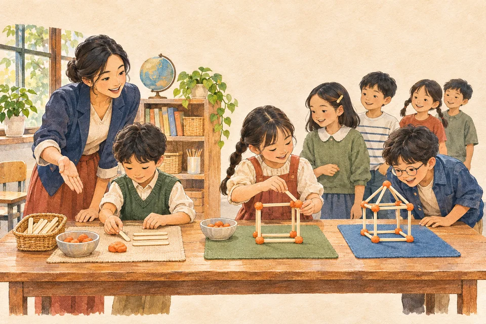

# DMEE-Class-T｜结构组织｜教师自评频次导读

## 让活动之间的线索接得上

一节课可能有很多好活动，学生仍需要看见它们前后如何连接。这个分组记录你怎样提醒已有知识、梳理新内容，并把活动收束成能带走的线索。

## 怎样读结果

这个分组有 7 道频次题。汇总按每题列出原版七种选项的人数和比例，分母为该题已有有效选择的人数。未作答、未显示和拒答分别记录。没有有效选择时，留空比例。

一项做法出现得少，可能与课时、任务、教学阶段或资源有关。可以先找出值得讨论的一项做法，再对照课堂观察或学生作品理解背景。教师自报频次只说明这次记录到的实践，无法替代学生的实际学习经历。

## 下次试一件小事

把上一节课的一条结论贴在本次任务旁，开始时请学生指出用到哪一部分。结尾只留一句提示，让他们补全两者之间的关系，再决定下一次需要回顾什么。

## 题本与适用范围

对应 2023 年 Dierendonck 补充材料 S1 的作者英译题文和七级频次选项，题项按 S5 最终分组，原题号 9、10、11、12、13、14、15。图文为项目原创，供成年教师自我反思。研究以法文施测，独立英文分组的测量等值尚未建立。本导读只展示逐题类别结果，不计算 ESEM 因素分数、教学质量分或综合排名。

[论文](https://doi.org/10.3389/feduc.2023.1281431) · [补充材料 S1 和 S5](https://doi.org/10.3389/feduc.2023.1281431.s001) · [CC BY 4.0](https://creativecommons.org/licenses/by/4.0/)
