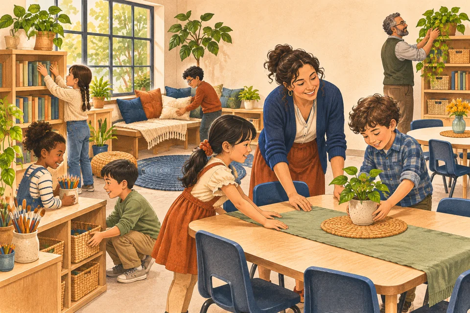

# DMEE-Class-T｜学习环境｜教师自评频次导读｜中文工作译本

## 给说出困惑留个位置

学习环境既包括活动秩序，也包括学生能否安心提出不懂、尝试和求助。这个分组记录你怎样组织和支持日常学习环境。

## 怎样读结果

这个分组有 4 道频次题。汇总按每题列出原版七种选项的人数和比例，分母为该题已有有效选择的人数。未作答、未显示和拒答分别记录。没有有效选择时，留空比例。

一项做法出现得少，可能与课时、任务、教学阶段或资源有关。可以先找出值得讨论的一项做法，再对照课堂观察或学生作品理解背景。教师自报频次只说明这次记录到的实践，无法替代学生的实际学习经历。

## 下次试一件小事

尝试一种低压力的表达方式，例如课末一张可以留空的疑问卡。下一次先回应出现多次的一个困惑，留意还有哪些同学因语言、时间或其他条件难以表达。

## 题本与适用范围

依据 2023 年 Dierendonck 补充材料 S1 的题文和七级频次制作简体中文工作译文，按 S5 最终分组，原题号 39、40、41、42。图文为项目原创，供成年教师自我反思。研究以法文施测，中文版及分组单独使用的测量等值尚未建立。本导读只展示逐题类别结果，不计算 ESEM 因素分数、教学质量分或综合排名。

[论文](https://doi.org/10.3389/feduc.2023.1281431) · [补充材料 S1 和 S5](https://doi.org/10.3389/feduc.2023.1281431.s001) · [CC BY 4.0](https://creativecommons.org/licenses/by/4.0/)
