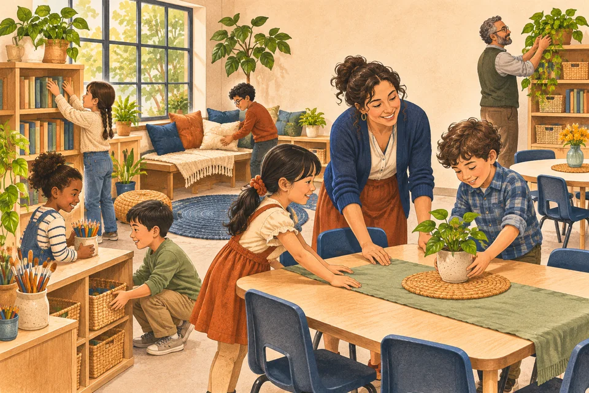

# DMEE-Class-T｜完整55题｜中文版反馈导读

## 看一节完整的课，不急着打分

一堂课从学生理解目标开始，再经过提问、示范、练习和回看学习证据。完整表把这些做法放在一起，方便教师回看其中哪一步值得多看一眼。先想起一节具体的课，再看看平常的经历是否一致。

## 怎样读结果

全卷保留原研究最终留用的 55 道题及原始顺序。七档逐项呈现有效选择的人数和比例，留空单列。只观察与实际任务相符的做法，并结合课堂记录讨论。结果不计算总分、因素分或教师等级。

## 下次试一件小事

选一个环节，在备课时写下一句你希望看到的学习表现。下课后从一份匿名作品或一次短交流找一个例子，决定下次继续哪一个做法、从哪里调一点。

简体中文为项目工作译文，采用原版七档对应的类别和既有无分表单机制。读完整卷时不必再重复填写八个分组。

[原始论文](https://doi.org/10.3389/feduc.2023.1281431) · [原题和分组附录 S1、S5](https://doi.org/10.3389/feduc.2023.1281431.s001)
