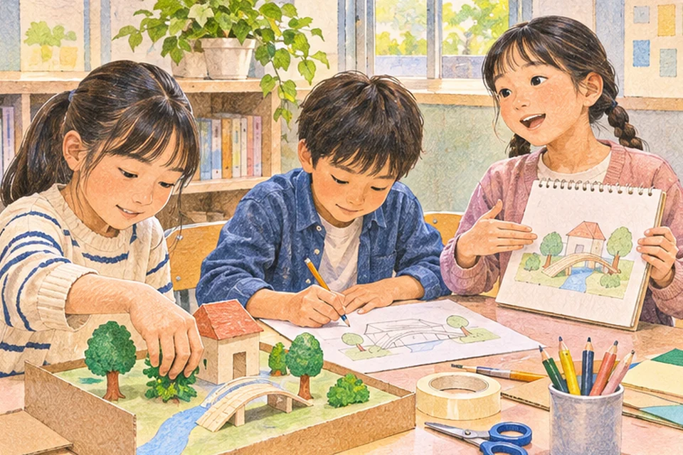

# Massachusetts DESE · 3–5 年级学生 迷你卷 I 与 II

## 让目标和参与机会接在一起

一个任务可以有清楚的目标，也可以让不同的孩子找到自己的参与方式。固定 12 题合并版把两类经历放在同一次反馈里，阅读时仍按原题分开看。

## 跟着题号读一行

同一版、同一群组逐题汇总。比例的分母为该题的有效作答人数。空白单独记数；教职工版另列不适用。没有有效作答时，比例显示为横线。这份报告用于讨论教学或管理实践。

从原题号定位到该题，再按官方选项顺序看人数与有效比例。遇到回应较少或分布较散的题，结合课堂观察了解背景。

## 下一步可以试试

挑一个合作活动，把目标说清，再提供说、写或摆材料的参与选择。记录哪一种选择让更多孩子有了实际贡献。

## 发布状态与原件

供3–5 年级学生所在班级的教师查看群体反馈。表单为 12 道编号题。可选评论按原施测说明另行处理。

这是供具备授权的管理员制作匿名群体统计的独立报告。题号对应原版。施测题本及其中文改编另行授权；本包没有题文、个人答案、评论原文或评分。

正式量表计分待核。合并版 12 题的独立结构、指标权重及评分证据；不能用8与10题文件拼接来复建。

[官方原件](https://www.doe.mass.edu/edeval/evidence/feedback/g3-5mini-form-i-ii.docx) · [施测说明](https://www.doe.mass.edu/edeval/evidence/feedback/g3-5-admin-protocol.docx)

<!-- mass_dese_student_mini_i_ii_g3_5_en@1.0.0 3adf250d2424648bc30c5f3426b9f41e09f35ec22b4f8bca4f9cfa8152e9b31b -->
