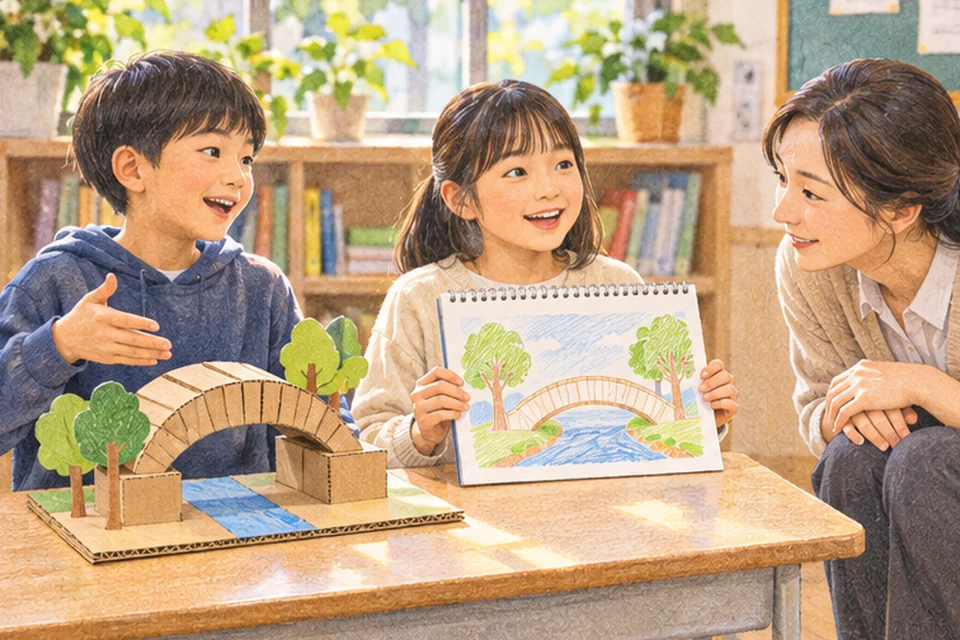

# Massachusetts DESE · 3–5 年级学生 迷你卷 II

## 给每个孩子一条走进任务的路

同一个任务，有的孩子靠看图理解，有的孩子要先动手。这 10 道题帮助你看看学生进入课堂活动时的具体经历。

## 跟着题号读一行

同一版、同一群组逐题汇总。比例的分母为该题的有效作答人数。空白单独记数；教职工版另列不适用。没有有效作答时，比例显示为横线。这份报告用于讨论教学或管理实践。

从原题号定位到该题，再按官方选项顺序看人数与有效比例。遇到回应较少或分布较散的题，结合课堂观察了解背景。

## 下一步可以试试

在一个已有任务中给出两种起步方式，例如先看例子或先试一遍。观察孩子怎样进入任务，再决定是否保留两种方式。

## 发布状态与原件

供3–5 年级学生所在班级的教师查看群体反馈。表单为 10 道编号题。可选评论按原施测说明另行处理。

这是供具备授权的管理员制作匿名群体统计的独立报告。题号对应原版。施测题本及其中文改编另行授权；本包没有题文、个人答案、评论原文或评分。

正式量表计分待核。Mini II 当前学段的独立验证及项目聚合口径，不能变成能力、满意度或教师等级。

[官方原件](https://www.doe.mass.edu/edeval/evidence/feedback/g3-5mini-form-ii.docx) · [施测说明](https://www.doe.mass.edu/edeval/evidence/feedback/g3-5-admin-protocol.docx)

<!-- mass_dese_student_mini_ii_g3_5_en@1.0.0 ea5a1eef4fce78a6a6578f947c61c5d3f48579189cb6b93eeef4afd907cc92ac -->
