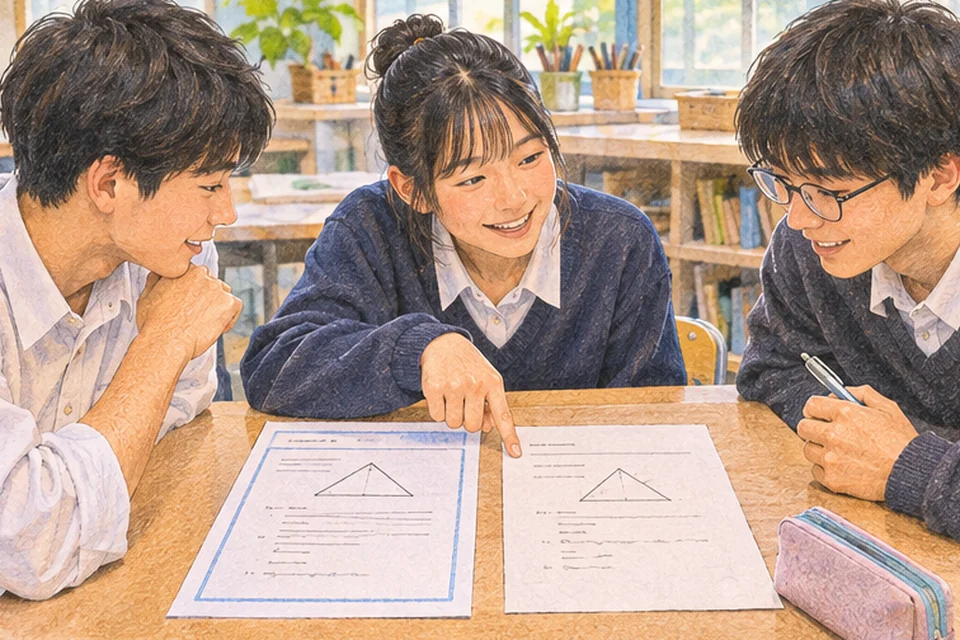

# Massachusetts DESE · 6–12 年级学生 迷你卷 I

## 让反馈能落到下一次尝试

这 8 道题围绕课程、教学与评价。从学生所经历的目标、活动和反馈出发，看看有没有哪一处安排值得调整和再看。

## 跟着题号读一行

同一版、同一群组逐题汇总。比例的分母为该题的有效作答人数。空白单独记数；教职工版另列不适用。没有有效作答时，比例显示为横线。这份报告用于讨论教学或管理实践。

从原题号定位到该题，再按官方选项顺序看人数与有效比例。遇到回应较少或分布较散的题，结合课堂观察了解背景。

## 下一步可以试试

给同一项作业的下一次尝试安排一个能看见的反馈步骤。收集两份去身份作品，看看学生能否把提示用到改进中。

## 发布状态与原件

供6–12 年级学生所在班级的教师查看群体反馈。表单为 8 道编号题。可选评论按原施测说明另行处理。

这是供具备授权的管理员制作匿名群体统计的独立报告。题号对应原版。施测题本及其中文改编另行授权；本包没有题文、个人答案、评论原文或评分。

正式量表计分待核。该学段 Mini I 的独立验证、已核定编码及指标解释；不得替用低学段参数。

[官方原件](https://www.doe.mass.edu/edeval/evidence/feedback/g6-12mini-form-i.docx) · [施测说明](https://www.doe.mass.edu/edeval/evidence/feedback/g6-12-admin-protocol.docx)

<!-- mass_dese_student_mini_i_g6_12_en@1.0.0 bb3411253ed01280586fb93abf17faf124caa57bdb96581dfe84f3626002db02 -->
