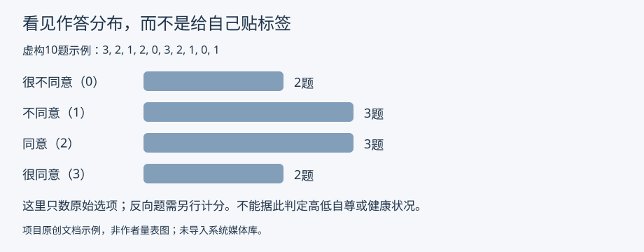

# Rosenberg自尊量表（中文研究译稿）

DRAFT/CANDIDATE/PILOT；成人本人自评，中文人工译审PENDING；ADULT_SELF/student为技术受众映射。现有源库未发现同一工具原题重复。

采用PhenX顺序：正1、2、4、6、7；反3、5、8、9、10。SD0/D1/A2/SA3，反向3−x，总分0–30；不与另一题序、10–40计分混用。

无经验阈值则不造。现有C/P/R轴、描述性反馈及理论范围图；外部研究出处不冒充中文常模。标签与指导语投影沿用已知现有机制，不改核心。

## 原创文档配图

仅文档说明资产，未上线媒体库；不是常模、临床分档或作者原图。SVG源码/XML检查已完成，当前环境浏览器无法创建headless profile，未声称渲染视觉检查通过。

## 报告修订1.0.1

正文改为生活化解释、各维度独立反思与可选行动；统一限制集中说明，未改变题目、计分、参数/参考策略、许可和工具身份。原报告1.0.0及旧示例保存在 `report-revisions/1.0.1/`，当前实际示例为1.0.1。`local-validation.json`是初版历史证据；本次证据见该修订目录。数据库必须经既有报告轴revision路径新增快照，不能覆写旧快照。
