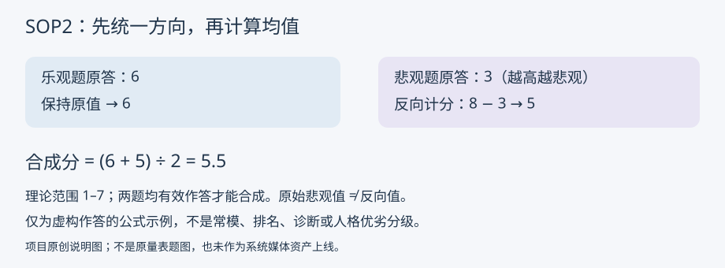

# SOP2 中文研究工作译稿

DRAFT / CANDIDATE / PILOT；成人自评，ADULT_SELF/student为既有技术映射不表示儿童。源库未发现同工具重复；与IPIP乐观、LOT-R不是同一量表。

- 两题完整定义及问题保留，分别使用乐观/悲观1–7端点；中间2–6仅数字，无虚构文字锚点。
- 合成=(乐观原答+8−悲观原答)/2，范围1–7、步长0.5；两题完整才计分。原始悲观值不是反向值，报告不另造“悲观分量表”。
- 经验参数只在出处档案中，不自动用英德成人样本比较中文个体；referencePolicy=none。
- 现有C/P/R版本轴、理论范围图和描述性报告；保持人工译审PENDING。
- CC BY4署名、链接及改动说明保留在source、双语文件和报告免责声明。指导语是每题定义，不另造独立指导语。
- 全构念分类标签保存于source，现有库标签投影边界不在本批改核心。

## 原创文档示意图

该SVG仅用于说明计分方向，是项目原创文档资产，不在题目旁展示，也未导入媒体库或宣称正式上线。
