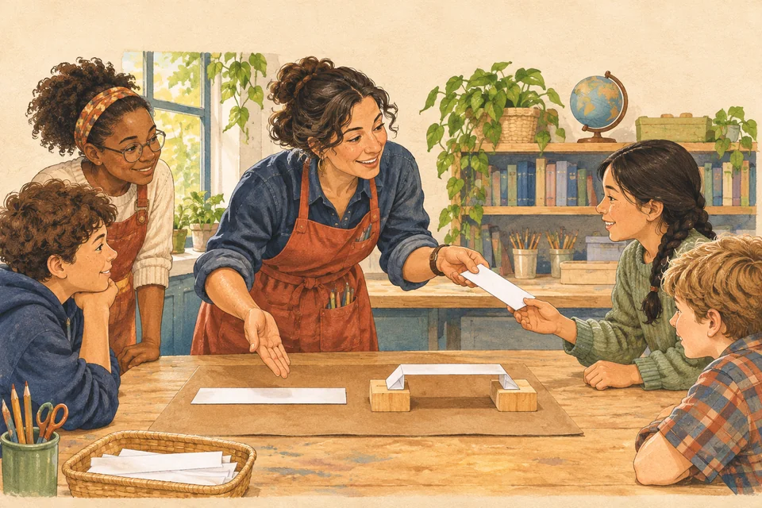

# 让学生用不同方式把同一件事讲清楚

IATPDI｜产出 7 题（M2）｜简体中文工作译本

一张图、一段讲解、一件小作品，都能让理解变得可见。形式可以选择，教师和学生需要共享清楚的目标。能不能解释想法、给出理由并举出合适的例子，比成果看起来是否热闹更容易讨论。

## 回到课堂试一步

为下一次成果任务写下两条所有形式都适用的要求。让学生在图示和口头说明之间选一种，再各找一份作品比较哪些证据清楚。

## 怎样读这份记录

这组记录你怎样安排学生展示学习成果。判断是否理解要回到共同目标和作品证据。本表不给教师或作品打分。 未填写的部分保留为空。需要填写时，可以回到一堂记得清楚的课。

*图为 EDUK12 原创概念插画，沿用既有课堂教研系列。*

[原始论文](https://doi.org/10.3389/feduc.2024.1445865) · [CC BY 4.0](https://creativecommons.org/licenses/by/4.0/)
