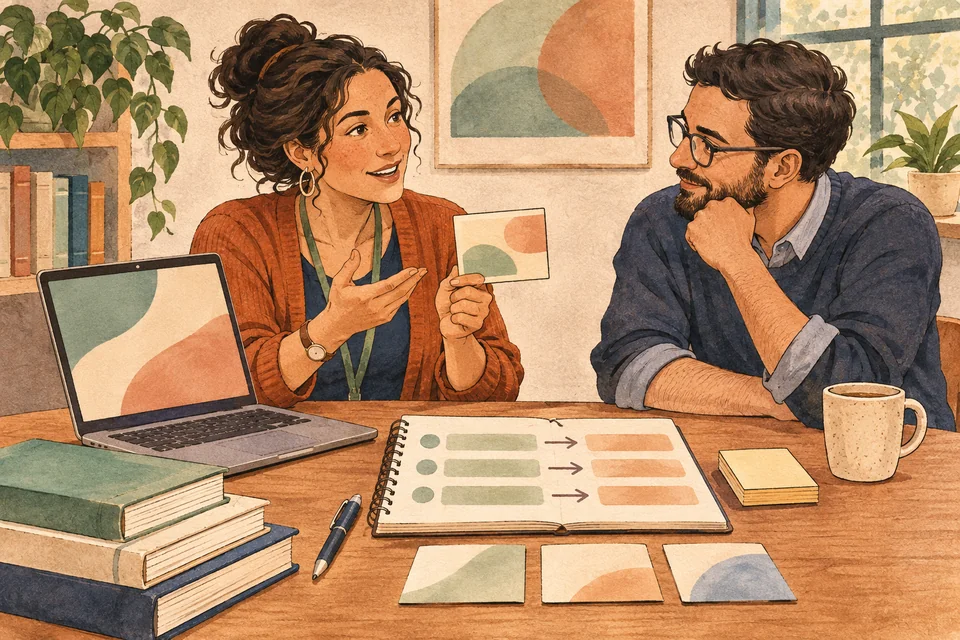

# SELFIEforTEACHERS｜2022 Toolkit 中文试用版

数字教学的改变可以很小。一份资料在学生手机上打开得顺不顺，一条反馈有没有接到学生下一次尝试，都能提供线索。这份自评带你看六个领域里的具体实践，挑一个本周能动手的小调整。

## 作答说明

请回想你当前在教学中使用数字技术的做法。每题只选一条最符合现状的描述。A1 到 C2 是这项实践的不同阶段。如果此前不了解这项能力，请选「我不了解这项能力」。结果用于个人专业学习与反思。

## 怎样理解结果

按欧盟 JRC 2022 Toolkit 固定英文题本翻译 32 项。每项保留原有六条实践描述及额外的「我不了解这项能力」选项。原值 0 为有效选择，留空仍是缺答。

- 专业参与，9 项，绑定独立中文图文报告 1.1.0-teacher-illustrated。
- 数字资源，5 项，绑定独立中文图文报告 1.1.0-teacher-illustrated。
- 教与学，5 项，绑定独立中文图文报告 1.1.0-teacher-illustrated。
- 评价，3 项，绑定独立中文图文报告 1.1.0-teacher-illustrated。
- 学习者赋能，4 项，绑定独立中文图文报告 1.1.0-teacher-illustrated。
- 培养学习者数字能力，6 项，绑定独立中文图文报告 1.1.0-teacher-illustrated。

各维度或项目分别反馈。中文译本处于试用阶段，尚待本地验证。面向中小学教师，用于个人数字教学实践反思。只有获准接收的教师本人可查看个人结果。

## 可以试的一件事

选一项能在下一节课试的实践。先写一句你期待能观察到的变化，课后再和一位同事对照教师、学生各自看到的情况。

[原件与署名](https://publications.jrc.ec.europa.eu/repository/handle/JRC129699)
