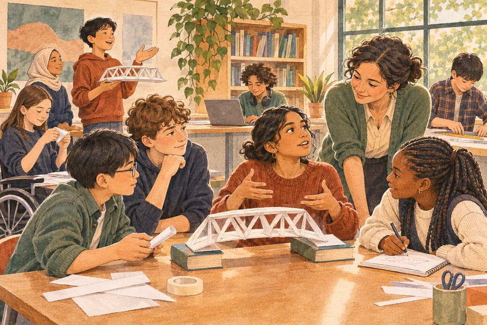

# 课堂体验 WIHIC｜56 题中文试用版

同一间教室里，有的同学很容易开口，有的同学需要一点时间才找到自己的位置。你可以从七个方面看回去，想一件愿意保留的事，也想一件希望下次有些变化的事。

## 作答说明

请想一想你现在评价的这门课里实际发生过什么。每题请选择最符合自己经历的一个频率，从「几乎从不」到「几乎总是」。答案没有对错，请根据自己的经历作答。

## 怎样理解结果

按 2023 年英文实际课堂版附录 A 直译 56 题。五档依原序计 1–5，每个题组答全八题才显示独立均分。这份中文工作译本与另行发表的中国学生 52 题验证版分别保留。

- 同学凝聚，8 项，绑定独立中文图文报告 1.1.0-student-illustrated。
- 教师支持，8 项，绑定独立中文图文报告 1.1.0-student-illustrated。
- 课堂参与，8 项，绑定独立中文图文报告 1.1.0-student-illustrated。
- 探究活动，8 项，绑定独立中文图文报告 1.1.0-student-illustrated。
- 任务导向，8 项，绑定独立中文图文报告 1.1.0-student-illustrated。
- 同伴合作，8 项，绑定独立中文图文报告 1.1.0-student-illustrated。
- 课堂公平，8 项，绑定独立中文图文报告 1.1.0-student-illustrated。

各维度或项目分别反馈。中文译本处于试用阶段，尚待本地验证。面向能理解简体中文的初中学生，作答及反馈用于个人课堂体验回顾。

## 可以试的一件事

选一门最近上过的课，回想一次你没有说完或有人帮你说清楚的事。写下具体发生了什么，必要时和信任的成年人商量可以怎样处理。

[原件与署名](https://doi.org/10.3390/educsci13030257)
