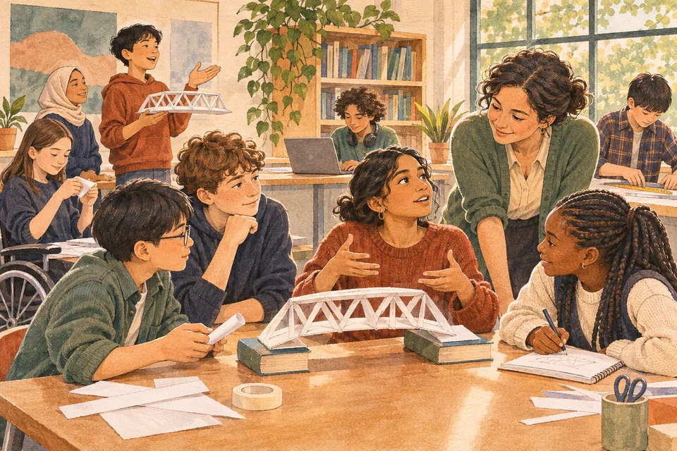

# 课堂体验 WIHIC｜56 题英文实际课堂版

## 看看同一间教室里，有哪些经历值得多留一点空间。

同一堂课里，有人很容易加入讨论，有人需要一点时间才找到开口的机会。报告记录的是你在这门课里经历了什么。七个方面各自呈现，方便你把想说的感受变成一个具体例子。

## 怎样读这份报告

五级选项依次对应 1–5。各维度答全八题才计算均分。缺题只影响对应维度。组合保留七个独立结果，避免把不同课堂体验挤进一个总分。

- 同学凝聚，8 项。1.1.0-student-illustrated。
- 教师支持，8 项。1.1.0-student-illustrated。
- 课堂参与，8 项。1.1.0-student-illustrated。
- 探究活动，8 项。1.1.0-student-illustrated。
- 任务导向，8 项。1.1.0-student-illustrated。
- 同伴合作，8 项。1.1.0-student-illustrated。
- 课堂公平，8 项。1.1.0-student-illustrated。

## 这周可以试一件事

想起一次课堂上觉得顺手或卡住的时刻，写一句当时发生了什么。如果愿意，可以把这句话带给信任的成年人，讨论怎样让下次更容易参与。

## 版本与适用范围

历史英文表 A1 的 56 题、题序和五级频次全部沿用。 Fraser 2023 表 A1 英文原题依原序组卷，供能读懂英文的初中学生试用；报告可见范围沿用现有授权，只提供给有权查看个人反馈的人。

[原件与署名](https://doi.org/10.3390/educsci13030257)

现有普通组合按同目录清单装配。图文组件均引用精确版本。
