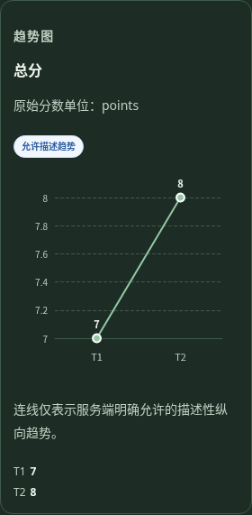
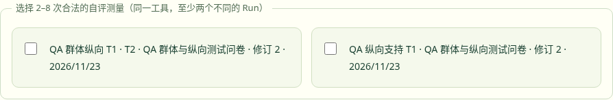

# School 新 main 九账号回归与修复（2026-11-23）

基线为 `9af040c8a7bf98a98e0ce70d96cb40101cc6e93a`（已包含前轮 School PR #798）。本轮在云端独立数据库 `eduk12_school_main_audit` 中，对原有九个账号重跑全部可达入口、链接、交互及协作流程，并保留原始失败、修复后的截图和新增测试数据。下列问题是在本轮扩大场景后发现，不能据此认定均由该 main 新引入。

## 修复结果

| 编号 | 触发问题 | 最终行为与验证 |
| --- | --- | --- |
| N01 | 纯表单组合问卷可勾选个人报告，但发布返回 400 | 配置读取与发布共用同一资格规则；不支持时禁用并解释。纯表单组合不生成报告，原直接 FORM 契约保留，混合组合正常发布。 |
| N02 | 已完成每日记录重开为空白 | School 经原授权守卫读取当前学生的原提交，按只读内容展示；其他学生提交与内部哈希不返回。原 28 字记录实测可见。 |
| N03 | 家长、教师保存退出后使用旧任务卡再次同意，返回 409 | 退出/交卷后重新读取权威任务状态，排队刷新并忽略旧请求。家长、教师、班主任均恢复同一 attempt 的五题草稿后完成交卷。 |
| N04 | 个体纵向来源显示很长的内部键 | 只在原授权来源内投影固定版本标题/修订号；无标签时用中性文案，保持 CLIENT 关系终止后 404。 |
| N05 | 普通教师账户出现无用途的敏感操作验证表单 | 按实际管理/专业/报告权限显示入口；后台 MFA 要求不变。 |
| N06 | 报告隐藏有效人数时，句子中的 N 为空 | 显示 `—`，不补算或披露被隐藏人数。实际两页 PDF 已检查。 |
| N07 | 断网提交仅显示英文 Failed to fetch | School 真实网络错误显示中文连接提示；HTTP 消息、code、401、AbortError 和重试行为不变。离线 START 未成功，联网后仍 PENDING。 |
| V01 | 内容编辑区内层留白过多、MFA 表单字体与间距不一致 | 收紧 School 局部布局，桌面及移动端明暗主题复验。 |
| V02 | 登记与纵向分析控件边界、标签不清楚 | 补齐边框、标签间距和移动端单列，控件高度 44–46px，键盘焦点可见。 |
| V03 | 320/390px 活动导航最后一个键盘焦点被裁切 | 小屏改为 2×2 布局，四个入口均可见且可键盘激活。 |
| V04 | 深色作答错误提示对比度 1.47:1 | 局部错误提示提升为 9.36:1；未改题目或认知任务配色。 |
| V05 | 深色趋势图继续读取根节点浅色 token，切主题不更新 | 从图表宿主读取继承 token、监听主题属性并清理观察器；同一报告明→暗→明不再请求报告 API，点值与几何不变。深色数据标签/轴文字对比度分别为 12.91/8.95。 |

## 验证范围与结果

- 原九账号：`school_admin`、`school_admin2`、`school_counselor`、`school_reviewer`、`school_teacher`、`school_homeroom`、`school_student`、`school_peer`、`school_parent`。管理/专业四入口和其余五入口均检查导航、唯一内部链接、后退/前进、搜索、排序、视图切换、刷新、响应式、明暗主题与键盘操作；另测公开主页、加入、登记和恢复入口。
- 实际协作：双管理员 MFA 重置和重新绑定；事件阻断审批→冻结合成账号→补发→独立审批；101 行名册导入暂停/重载/续传；新增家庭邀请→认领→学生确认→撤回→旧码拒绝；双重同意、撤回/重新同意及无自评的 10 对同伴分配；内容 CRUD、双窗口旧版本 409、已发布版本只读。
- 新测评共分配 34 份，原学生/同伴/家长/教师/班主任完成 19 份，新增 221 条表单题答案及 12 条量表题答案；其余 15 份为辅助学生保留的待测任务。表单 13 题型、量表及组合问卷、保存退出/恢复/完成/反馈均有真实浏览器证据。
- 工具编制另外实测表单 CSV/文本导入、13 题型预览/保存/冻结/固定版本、量表反向题与维度计分（实际总分 6、两题维度均分 1）、共享校验/提交/读取/撤回、组合问卷编排/上下文/保存/预览。保留 3 个新草稿、2 个固定版本与撤回历史。
- 后端 136 文件 **803 项通过**（592 单元、211 真 PostgreSQL 集成）；一个仅用于旧 fixture 修复续跑的替代分支主动跳过，其正常新 fixture 路径已通过。前端 118 文件 **674 项通过**，另 2 文件 **68 项入口宿主契约通过**。前后端受影响类型检查通过；变化文件 Lint 无错误，既有警告如实保留。
- 最终前端构建成功，构建前后 2,293 个输入一致。源码浏览器验证使用 `http://school.localhost:5173` 的 Vite 与真实本地后端；**没有完成生产构建产物的 School 浏览器验收**，不将两者混称。
- 前轮 F01–F10 已重新验证：授权/撤销、公开加入、工具新建冻结、多孩子标签、工具标题、三类内容维护/冲突/发布只读、双管理员 MFA、活动生命周期、群体报告名称、INCOMPLETE/FROZEN 提示。

## 数据与证据

原数据库 `eduk12_dev` 未被本轮业务写入；原 143 条表单题答案、2 份报告及原 49 个执行（32 已完成）逐行哈希/状态核对不变。原九账号密码/MFA 密钥和有效状态不变；原 6 条家庭关系继续有效，新增第 7 条关系已撤回。测试数据最终保存为私有 PostgreSQL custom dump，密码、TOTP、恢复码和邀请凭据不提交到 GitHub。

完整云端证据位于 `/workspace/shared/school-main-audit-20261123/`：可读报告、脱敏原始尝试、逐阶段统计、截图、PDF、测试摘要和 SHA-256 清单。私有快照位于 `/workspace/school-testing/main-audit-20261123/private/`。本文件只提交两张小型关键截图，完整测试数据和凭据不入库。

## 未覆盖与工具限制

- 当前隔离库没有获批并授权给学校的 COGNITIVE/SJT/BUNDLE 登记资源、受保护报告来源/方案、个体纵向已审批方案、专业报告/家长披露产物。因此验证了可达入口、空态、禁用和拒绝路径，未宣称上述正向发布链通过，也未伪造审批/授权。
- Headless Chromium 合成 Escape 未退出浏览器原生全屏；应用内退出后打印和普通打印均通过，物理 Escape 仍待可见桌面验证。
- 5,001 行一次性 `.fill()` 在裸 HTML textarea 同样导致 Chromium 卡住；文件上传的同等超限输入已实测拒绝且保留已有输入。该自动输入限制保留在失败历史中。
- 首轮定位器、异步焦点时机、最近 MFA 过期、错误 fixture、低负载超时等失败原文与对应复验均留存；不将每次成功记录相加冒充独立功能总数。GROUP 后续时间窗口使用明确标注的合成老化 fixture。
- 生产形似域名的本地拦截方案被自动审批拒绝后，已改用节点 localhost；未重试该方案、未访问生产做业务测试。无生产部署、正式 CI 接纳、合并资格或备份恢复资格声明。

## 差异与检查执行边界

本次同时修改 School 前后端及共享报告显示组件，按未知/混合范围保守处理；不是纯 CSS 或 backend-only 路线。无 schema、依赖、锁文件、CI 或部署配置修改，无计分/隐私阈值变更。主要验证位置是本云端隔离环境；每次失败保留原记录，仅对实际变化/缺失项定向重验，最后一次冻结输入构建不重复。构建后的文档和截图不使应用输入失效。本 PR 保持 Draft，不额外启动全平台 CI、合并或生产发布。
